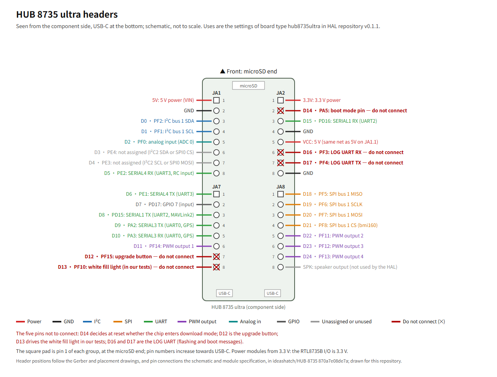

# ArduPilot examples for the HUB 8735 ultra

繁體中文：[README.md](README.md)

Board examples for running ArduPilot on the HUB 8735 ultra development board (vendor ideasHatch, [vendor resources](https://github.com/ideashatch/HUB-8735)): how to connect the sensors, hwdef overlays, parameter templates, and what each example has been verified to do on a board. An unofficial project maintained by one person, unrelated to the ArduPilot development team, Realtek and the board vendor.

**Not flight-tested. Do not use it for flight.** Read "Flight safety" before you start.

## How this relates to the HAL repository

- The chip port lives in [rainwu0/ArduPilot-RTL8735B](https://github.com/rainwu0/ArduPilot-RTL8735B) (the HAL repository below) and works for any RTL8735B board; building, flashing and the board type `hub8735ultra` are all there.
- This repository only holds examples for the HUB 8735 ultra and contains no ArduPilot code itself. To use one, build the HAL repository at a release tag, then add the example on top.
- Every example states the HAL repository tag it was verified with; the current one is `v0.1.1`. When an example moves to a new HAL repository tag, its board test table is marked again for that tag.

## Examples

| Example | Sensors | HAL repository tag | Board test |
|---|---|---|---|
| [bmi160-bmp280-qmc5883l](examples/bmi160-bmp280-qmc5883l/README.en.md) | BMI160, BMP280, QMC5883L | `v0.1.1` | Pending |
| [expansion-board-handbuilt](examples/expansion-board-handbuilt/README.en.md) | BMI160, BMP280, QMC5883L, on a hand-built expansion board with headers for battery voltage, motors, ESC, GPS, RC and external I²C | `v0.1.1` (battery voltage and the ESC version need a later release) | Pending |

What each example contains, and its checks, are in [CONTRIBUTING](CONTRIBUTING.en.md); the changes in each version of this repository are in the [CHANGELOG](CHANGELOG.en.md).

## Board headers



Vector version: [docs/pinout.en.svg](docs/pinout.en.svg).

- The uses are the settings of board type `hub8735ultra` in HAL repository `v0.1.1`. D3 and D4 are not assigned; an overlay can make them I²C2 or SPI0 (see Custom boards in the HAL repository README).
- The five pins not to connect: the level of D14 (JA2.2) at reset decides whether the chip enters download mode, and shorting it to the 3.3 V next to it (JA2.1) before a reset enters download mode (pages 17–18 of the vendor's [Chinese user guide](https://github.com/ideashatch/HUB-8735/blob/870a7e08de7a/HUB%208735%20ultra%20toolkit/Software/HUB%208735%20ultra%20%E9%96%8B%E7%99%BC%E6%9D%BF%E3%80%90Arduino%20%E4%BD%BF%E7%94%A8%E8%AA%AA%E6%98%8E%E3%80%91_20240508.pdf)); D12 (JA7.7) is the upgrade button; D13 (JA7.8) drives the white fill light on the board in our tests; D16 (JA2.6) and D17 (JA2.7) are the LOG UART, which carries flashing and boot messages.
- 5V (JA1.1) and VCC (JA2.5) are the same 5 V, also shared with the 5 V of both USB-C connectors; 3.3V is on JA2.1, and GND on JA1.2, JA2.4 and JA2.8.
- Header positions follow the vendor's published [Gerber](https://github.com/ideashatch/HUB-8735/blob/870a7e08de7a/HUB%208735%20ultra%20toolkit/Hardware/HUB%208735%20ultra%20PCB%20Gerber%20File.7z) and [placement drawing](https://github.com/ideashatch/HUB-8735/blob/870a7e08de7a/HUB%208735%20ultra%20toolkit/Hardware/HUB%208735%20ultra_PCB%20Placement_Top.pdf), and the pin connections the [schematic](https://github.com/ideashatch/HUB-8735/blob/870a7e08de7a/HUB%208735%20ultra%20toolkit/Hardware/HUB%208735%20ultra%20Schematic.pdf) and [module specification](https://github.com/ideashatch/HUB-8735/blob/870a7e08de7a/HUB%208735%20ultra%20toolkit/Hardware/HUB%208735%20ultra%20Module%20Specification_V01_20240508.pdf) (all in ideashatch/HUB-8735 `870a7e08de7a`); the figure is drawn for this repository.

## Using an example

1. Set up your environment with the HAL repository's [Getting started][start], and switch to the tag the example names (`v0.1.1` below).
2. Clone this repository into your home directory: `git clone https://github.com/rainwu0/ArduPilot-Hub8735Ultra.git ~/ArduPilot-Hub8735Ultra`.
3. Wire the board as in the example README's wiring table.
4. Add the example's overlay when you build (replace `<example>` with the example's directory name):

   ```bash
   cd ~/ArduPilot-RTL8735B
   git checkout v0.1.1
   ./waf configure --board hub8735ultra --extra-hwdef $HOME/ArduPilot-Hub8735Ultra/examples/<example>/overlay.dat
   ./waf copter
   ```

5. Flash and connect a ground station: steps 6 to 8 of the HAL repository's [Getting started][start].
6. Use your ground station's load-parameters-from-file feature to load the files you want from the example's `params/`, in the order of their file name numbers, then reboot.
7. Check orientation and failsafes on the ground as described in "Flight safety".

## Flight safety

- Neither the HAL repository nor the examples here have flown. "Verified on a board" in an example only means the listed checks were done on a board on a desk; it does not mean it can fly safely.
- **Keep the propellers off** while wiring, flashing, changing parameters and checking orientation.
- Before arming, check on the ground that pitch goes positive when the front is lifted and roll goes positive when the right side goes down (ArduPilot's convention), and that the failsafe parameters are set and have been tried in SITL.
- MAVLink over Wi-Fi has no authentication at all: other devices on the same subnet may be taken as the ground station, and their RC override is accepted too. Use it only on a dedicated network you control; for details see [Wi-Fi][wifi] in the HAL repository README.
- Wi-Fi connections can drop. If you control the vehicle over Wi-Fi only, always enable the ground station loss failsafe.
- Follow the drone regulations where you are, and test where nobody and nothing can get hurt.
- As the licenses say, the contents of this repository come with no warranty; use them at your own risk.

## Getting involved

Questions and board results are welcome as issues; problems outside the examples (building, flashing, the HAL itself) belong in the HAL repository. Details are in [CONTRIBUTING](CONTRIBUTING.en.md).

## License

| Content | License | Full text |
|---|---|---|
| Code and firmware settings (overlays `.dat`, parameter files `.parm`, tools) | GPL-3.0-or-later | [LICENSES/GPL-3.0-or-later.txt](LICENSES/GPL-3.0-or-later.txt) |
| Documents, wiring tables and wiring diagrams | CC-BY-4.0 | [LICENSES/CC-BY-4.0.txt](LICENSES/CC-BY-4.0.txt) |
| Expansion board design files (`hardware/`) | CERN-OHL-P-2.0 | [LICENSES/CERN-OHL-P-2.0.txt](LICENSES/CERN-OHL-P-2.0.txt) |

- Code and settings files start with an `SPDX-License-Identifier`; the file header is what counts.
- When you reuse the documents, credit the source: ArduPilot-Hub8735Ultra (https://github.com/rainwu0/ArduPilot-Hub8735Ultra).
- The license texts come from the official sites: GPL-3.0 from https://www.gnu.org/licenses/gpl-3.0.txt , CC-BY-4.0 from https://creativecommons.org/licenses/by/4.0/legalcode.txt , and CERN-OHL-P-2.0 from https://ohwr.org/cern_ohl_p_v2.txt as published by CERN.

[start]: https://github.com/rainwu0/ArduPilot-RTL8735B/blob/v0.1.1/libraries/AP_HAL_RTL8735B/GETTING_STARTED.en.md
[wifi]: https://github.com/rainwu0/ArduPilot-RTL8735B/blob/v0.1.1/libraries/AP_HAL_RTL8735B/README.en.md#wi-fi
