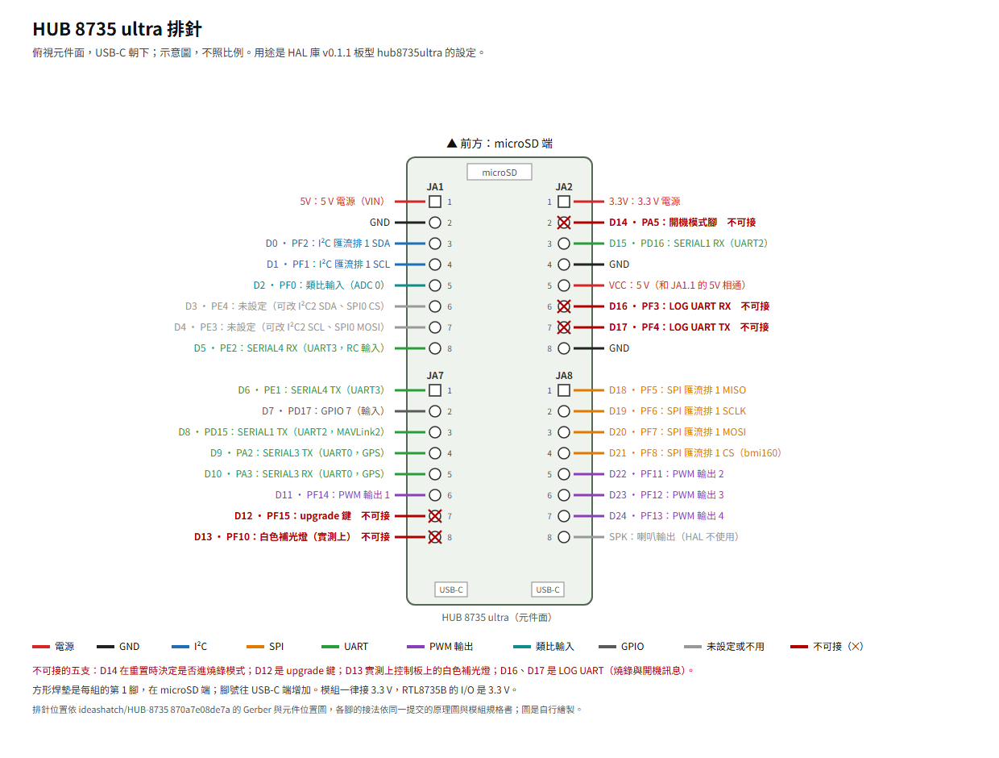

# HUB 8735 ultra 的 ArduPilot 範例

English: [README.en.md](README.en.md)

在 HUB 8735 ultra 開發板（板商 ideasHatch，[板商資料](https://github.com/ideashatch/HUB-8735)）上跑 ArduPilot 的實板範例：感測器怎麼接、hwdef 疊加檔、參數範本，以及每個範例在開發板上驗證過什麼。個人維護的非官方專案，跟 ArduPilot 開發團隊、Realtek、板商都沒有關係。

**還沒飛過，請勿用於飛行。** 動手之前先讀〈飛行安全須知〉。

## 和 HAL 庫的關係

- 晶片移植在 [rainwu0/ArduPilot-RTL8735B](https://github.com/rainwu0/ArduPilot-RTL8735B)（以下稱 HAL 庫），任何 RTL8735B 開發板都適用；建置、燒錄和板型 `hub8735ultra` 都在那裡。
- 這個庫只放 HUB 8735 ultra 的範例，本身沒有 ArduPilot 的程式。用的時候先照 HAL 庫的版本標籤建置，再疊上這裡的範例。
- 每個範例寫明驗證時用的 HAL 庫標籤，目前是 `v0.1.1`。範例改用 HAL 庫的新標籤時，驗證表照新標籤重新標狀態。

## 範例

| 範例 | 感測器 | HAL 庫標籤 | 上板驗證 |
|---|---|---|---|
| [bmi160-bmp280-qmc5883l](examples/bmi160-bmp280-qmc5883l/README.md) | BMI160、BMP280、QMC5883L | `v0.1.1` | 待驗 |
| [expansion-board-handbuilt](examples/expansion-board-handbuilt/README.md) | BMI160、BMP280、QMC5883L，手焊擴充板加電池電壓、馬達、電調、GPS、遙控、外接 I²C 的排針 | `v0.1.1`（電池電壓與電調版要之後的版本） | 待驗 |

每個範例的內容和驗證項目，見 [CONTRIBUTING](CONTRIBUTING.md)；這個庫每一版的變更，見 [CHANGELOG](CHANGELOG.md)。

## 開發板的排針



向量圖：[docs/pinout.svg](docs/pinout.svg)。

- 用途是 HAL 庫 `v0.1.1` 板型 `hub8735ultra` 的設定。D3、D4 沒有設定，疊加檔可以改成 I²C2 或 SPI0（見 HAL 庫 README 的〈自訂板〉）。
- 不可接的五支：D14（JA2.2）在重置時的電位決定是否進燒錄模式，和旁邊的 3.3 V（JA2.1）短路後重置就會進燒錄模式（板商[中文使用說明](https://github.com/ideashatch/HUB-8735/blob/870a7e08de7a/HUB%208735%20ultra%20toolkit/Software/HUB%208735%20ultra%20%E9%96%8B%E7%99%BC%E6%9D%BF%E3%80%90Arduino%20%E4%BD%BF%E7%94%A8%E8%AA%AA%E6%98%8E%E3%80%91_20240508.pdf) p.17–18）；D12（JA7.7）是 upgrade 鍵；D13（JA7.8）實測上控制板上的白色補光燈；D16（JA2.6）、D17（JA2.7）是 LOG UART，燒錄與開機訊息走這兩支。
- 5V（JA1.1）與 VCC（JA2.5）是同一個 5 V，也和兩個 USB-C 的 5 V 相通；3.3V 在 JA2.1，GND 在 JA1.2、JA2.4、JA2.8。
- 排針位置依板商公開的 [Gerber](https://github.com/ideashatch/HUB-8735/blob/870a7e08de7a/HUB%208735%20ultra%20toolkit/Hardware/HUB%208735%20ultra%20PCB%20Gerber%20File.7z) 與[元件位置圖](https://github.com/ideashatch/HUB-8735/blob/870a7e08de7a/HUB%208735%20ultra%20toolkit/Hardware/HUB%208735%20ultra_PCB%20Placement_Top.pdf)，各腳的接法依[原理圖](https://github.com/ideashatch/HUB-8735/blob/870a7e08de7a/HUB%208735%20ultra%20toolkit/Hardware/HUB%208735%20ultra%20Schematic.pdf)與[模組規格書](https://github.com/ideashatch/HUB-8735/blob/870a7e08de7a/HUB%208735%20ultra%20toolkit/Hardware/HUB%208735%20ultra%20Module%20Specification_V01_20240508.pdf)（都是 ideashatch/HUB-8735 `870a7e08de7a`）；圖是本庫自行繪製。

## 範例怎麼用

1. 照 HAL 庫的[〈從零開始〉][start]準備好環境，切到範例寫的標籤（下面以 `v0.1.1` 為例）。
2. 把這個庫 clone 到家目錄：`git clone https://github.com/rainwu0/ArduPilot-Hub8735Ultra.git ~/ArduPilot-Hub8735Ultra`。
3. 照範例 README 的接線表接線。
4. 建置時疊上範例的疊加檔（`<範例>` 換成範例的目錄名稱）：

   ```bash
   cd ~/ArduPilot-RTL8735B
   git checkout v0.1.1
   ./waf configure --board hub8735ultra --extra-hwdef $HOME/ArduPilot-Hub8735Ultra/examples/<範例>/overlay.dat
   ./waf copter
   ```

5. 燒錄、連上地面站：照 HAL 庫[〈從零開始〉][start]的第 6 到 8 步。
6. 用地面站的載入參數檔功能，照檔名的編號順序載入範例 `params/` 裡你要用的檔，再重開機。
7. 照〈飛行安全須知〉在地面確認方向和失效保護。

## 飛行安全須知

- HAL 庫和這裡的範例都還沒飛過。範例的「上板驗證」只代表在桌上的開發板做過列出的檢查，不代表可以安全飛行。
- 接線、燒錄、改參數、確認方向的時候，**不要裝槳**。
- 解鎖之前，在地面確認：前端抬起時 pitch 變正、右側朝下時 roll 變正（ArduPilot 的慣例）；失效保護的參數已經設好，也用 SITL 試過。
- Wi-Fi 上的 MAVLink 沒有任何驗證：同一個網段的其他裝置可能被當成地面站，它送來的 RC override 也會被接受。只在自己控制的專用網路使用，細節見 HAL 庫 README 的[〈Wi-Fi〉][wifi]。
- Wi-Fi 連線可能中斷。只靠 Wi-Fi 控制時，地面站失聯的失效保護一定要開。
- 遵守所在地的無人機法規，在不會傷到人和財物的地方試。
- 依授權條款，這個庫的內容不附任何保證，使用的風險自負。

## 參與

問題、上板結果都歡迎開 issue；範例以外的問題（建置、燒錄、HAL 本身）請到 HAL 庫。細節見 [CONTRIBUTING](CONTRIBUTING.md)。

## 授權

| 內容 | 授權 | 全文 |
|---|---|---|
| 程式與韌體設定（疊加檔 `.dat`、參數檔 `.parm`、工具） | GPL-3.0-or-later | [LICENSES/GPL-3.0-or-later.txt](LICENSES/GPL-3.0-or-later.txt) |
| 文件、接線表與接線圖 | CC-BY-4.0 | [LICENSES/CC-BY-4.0.txt](LICENSES/CC-BY-4.0.txt) |
| 擴充板設計檔（`hardware/`） | CERN-OHL-P-2.0 | [LICENSES/CERN-OHL-P-2.0.txt](LICENSES/CERN-OHL-P-2.0.txt) |

- 程式與設定檔的開頭有 `SPDX-License-Identifier`，以檔頭為準。
- 引用文件時請註明出處：ArduPilot-Hub8735Ultra（https://github.com/rainwu0/ArduPilot-Hub8735Ultra）。
- 授權全文取自官方網站：GPL-3.0 取自 https://www.gnu.org/licenses/gpl-3.0.txt ，CC-BY-4.0 取自 https://creativecommons.org/licenses/by/4.0/legalcode.txt ，CERN-OHL-P-2.0 取自 CERN 公布的 https://ohwr.org/cern_ohl_p_v2.txt 。

[start]: https://github.com/rainwu0/ArduPilot-RTL8735B/blob/v0.1.1/libraries/AP_HAL_RTL8735B/GETTING_STARTED.md
[wifi]: https://github.com/rainwu0/ArduPilot-RTL8735B/blob/v0.1.1/libraries/AP_HAL_RTL8735B/README.md#wi-fi
