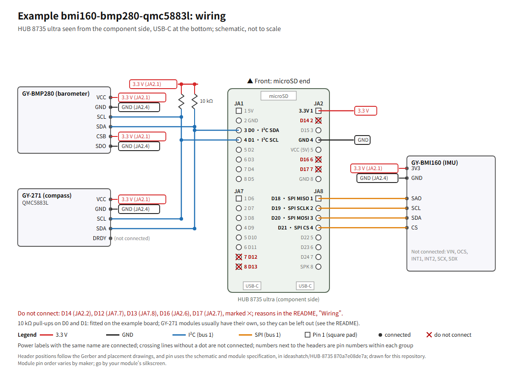

# Example: BMI160 + BMP280 + QMC5883L

繁體中文：[README.md](README.md)

Three common sensor modules connected to a HUB 8735 ultra as the flight controller's IMU, barometer and compass. On the example board the modules are soldered to a perfboard, and the board plugs into it.

**The files of this example have not yet finished the board test on a public HAL repository tag, and it has not flown.** For the status see "Board test"; before you start, read [Flight safety](../../README.en.md#flight-safety) on this repository's home page.

- HAL repository tag: `v0.1.1`
- Board type: `hub8735ultra`

## Sensor set

| Sensor | Module | Interface | Address or CS | Orientation in the overlay |
|---|---|---|---|---|
| IMU | GY-BMI160 | SPI bus 1 | CS on D21 | `ROTATION_ROLL_180_YAW_270` |
| Barometer | GY-BMP280 | I²C bus 1 | 0x76 | — |
| Compass | GY-271 (QMC5883L) | I²C bus 1, external | 0x0D | `ROTATION_NONE` |

The orientations match how the example board is placed: component side up, with the front at the microSD end (the end opposite the USB-C connectors). If you place it differently, test again; how is described under "Board test" (gravity test and turn test).

## Wiring

Header positions follow the Gerber and placement drawings the vendor published (`HUB 8735 ultra toolkit/Hardware/HUB 8735 ultra PCB Gerber File.7z` and `HUB 8735 ultra toolkit/Hardware/HUB 8735 ultra_PCB Placement_Top.pdf` in ideashatch/HUB-8735 `870a7e08de7a`): seen from the component side with the USB-C connectors at the bottom, there is one row on each side, each row has an upper and a lower group of 8 pins. The left row's upper group is JA1 and its lower group JA7; the right row's upper group is JA2 and its lower group JA8. Pin 1 of each group is the square pad at the microSD end, and the pin numbers increase towards the USB-C end. For the D number and use of every header pin, see this repository's [header figure](../../README.en.md#board-headers), compiled from the vendor's published [schematic](https://github.com/ideashatch/HUB-8735/blob/870a7e08de7a/HUB%208735%20ultra%20toolkit/Hardware/HUB%208735%20ultra%20Schematic.pdf) and [module specification](https://github.com/ideashatch/HUB-8735/blob/870a7e08de7a/HUB%208735%20ultra%20toolkit/Hardware/HUB%208735%20ultra%20Module%20Specification_V01_20240508.pdf).



Vector version: [wiring.en.svg](wiring.en.svg). The diagram and the table below show the same wiring.

The table below is how the example board is wired. Wired this way, a build of HAL repository `v0.1.0` detects all three sensors (T2 in the HAL repository's [BOARD_TESTS.md](https://github.com/rainwu0/ArduPilot-RTL8735B/blob/v0.1.0/libraries/AP_HAL_RTL8735B/BOARD_TESTS.md), in Chinese).

| Module | Module pin | Connect to | Header position |
|---|---|---|---|
| GY-BMI160 | 3V3 | 3.3 V | JA2.1 |
| GY-BMI160 | GND | GND | JA2.4 |
| GY-BMI160 | SCL | D19 (SPI clock) | JA8.2 |
| GY-BMI160 | SDA | D20 (SPI MOSI) | JA8.3 |
| GY-BMI160 | SAO | D18 (SPI MISO) | JA8.1 |
| GY-BMI160 | CS | D21 (SPI CS) | JA8.4 |
| GY-BMI160 | VIN, OCS, INT1, INT2, SCX, SDX | not connected | — |
| GY-BMP280 | VCC | 3.3 V | JA2.1 |
| GY-BMP280 | GND | GND | JA2.4 |
| GY-BMP280 | SCL | D1 (I²C SCL) | JA1.4 |
| GY-BMP280 | SDA | D0 (I²C SDA) | JA1.3 |
| GY-BMP280 | CSB | 3.3 V (selects I²C) | JA2.1 |
| GY-BMP280 | SDO | GND (address 0x76) | JA2.4 |
| GY-271 | VCC | 3.3 V | JA2.1 |
| GY-271 | GND | GND | JA2.4 |
| GY-271 | SCL | D1 (I²C SCL) | JA1.4 |
| GY-271 | SDA | D0 (I²C SDA) | JA1.3 |
| GY-271 | DRDY | not connected | — |

- Connect every module to 3.3 V, never to 5 V: the RTL8735B's I/O is 3.3 V. The GY-BMI160 is powered from its 3V3 pin, bypassing the regulator on the module.
- You can also find 3.3 V and GND from the silkscreen next to the board's header pins.
- I²C pull-ups: the example board has a 10 kΩ resistor from each of D0 and D1 to 3.3 V. GY-271 modules usually have their own pull-ups (inferred from the module sellers' specifications, not measured), so these two can be left out; if you later add other I²C modules with their own pull-ups, do not add them, or the total pull-up gets too strong.
- Pins not to connect: D14 (JA2.2), D12 (JA7.7), D13 (JA7.8), D16 (JA2.6), D17 (JA2.7), marked ✕ in the wiring diagram. The level of D14 at reset decides whether the chip enters download mode, and shorting it to the 3.3 V next to it (JA2.1) before a reset enters download mode (pages 17–18 of the vendor's Chinese user guide, `HUB 8735 ultra toolkit/Software/HUB 8735 ultra 開發板【Arduino 使用說明】_20240508.pdf` in the same commit), so take care not to bridge them when soldering; D12 is the upgrade button, D13 drives the white fill light on the board in our tests, and D16 and D17 are the LOG UART (see [Board types](https://github.com/rainwu0/ArduPilot-RTL8735B/blob/v0.1.1/libraries/AP_HAL_RTL8735B/README.en.md#board-types) in the HAL repository README).
- For tests on a desk, USB power is enough. To run from a battery, go through a 5 V BEC to JA1.1 (5V) and JA1.2 (GND); page 4 of the vendor's module specification lists a supply voltage of 4.75–5.25 V. **While the power header is powered, do not plug in USB**: per the vendor's schematic, the 5 V of both USB-C connectors goes straight to the 5V header pin with nothing in between; to use USB, first remove power from the header.
- Keep the compass away from power wires, the battery and magnetic parts.

## Build

Set up the environment and the Wi-Fi settings file and flash as in the HAL repository's [Getting started](https://github.com/rainwu0/ArduPilot-RTL8735B/blob/v0.1.1/libraries/AP_HAL_RTL8735B/GETTING_STARTED.en.md), and use this example's overlay when you build:

```bash
cd ~/ArduPilot-RTL8735B
git checkout v0.1.1
./waf configure --board hub8735ultra --extra-hwdef $HOME/ArduPilot-Hub8735Ultra/examples/bmi160-bmp280-qmc5883l/overlay.dat
./waf copter
```

- This is the overlay that Connecting sensors in the HAL repository uses. `hwdef/hub8735ultra/sensors-example.dat`, which HAL repository `v0.1.1` and earlier shipped, has the same sensor settings (this one also sets an explicit default that enables the compass); from `v0.2.0` the HAL repository no longer ships it and uses this one.
- No firmware images are provided: an image contains your Wi-Fi credentials, so build your own.
- Needs HAL repository `v0.1.1` or later: `v0.1.1` clears the I²C bus at boot, which fixes the occasional barometer initialization failure at boot in `v0.1.0` (see the HAL repository [CHANGELOG](https://github.com/rainwu0/ArduPilot-RTL8735B/blob/v0.1.1/libraries/AP_HAL_RTL8735B/CHANGELOG.en.md)).

## Parameters

Use your ground station's load-parameters-from-file feature to load the files in `params/` in the order of their numbers, then reboot:

1. `10-board.parm`: failsafes for control over Wi-Fi only. Land when RC override stops (`FS_THR_ENABLE 3`), land when the ground station link is lost (`FS_GCS_ENABLE 5`), and keep landing if a failsafe starts while landing (`FS_OPTIONS 8`).
2. `20-use-indoor-no-gps-no-rc.parm`: indoors, no GPS and no RC receiver. `GPS1_TYPE 0`; `RC_OPTIONS 33`: no receiver, and arming only with the throttle at its lowest. Once you add a GPS or a receiver, do not load this file.
3. `30-frame-quad-x-esc.parm`: an example frame, quad X, brushless ESCs on normal PWM at 490 Hz. For your own frame, change `FRAME_CLASS` and `FRAME_TYPE`. ESCs have not been tried on a board with the HAL repository yet; after fitting ESCs, calibrate them first, with the propellers off throughout.
4. `40-sensors.parm`: `COMPASS_USE 1`, so this compass is used for heading.

After loading, calibrate the accelerometer and the compass in the ground station. For the compass calibration, pick the board up and turn it through the six orientations in three dimensions; turning it flat on a desk is not enough. Set `AHRS_ORIENTATION` for how the board is mounted on the frame, then confirm it with the gravity test below.

## Board test

The board checks below are done with an image built from HAL repository `v0.1.1` plus the files in this directory.

| # | Check | Status |
|---|---|---|
| 1 | Boot and connection: Wi-Fi joined, the ground station receives heartbeats and can read parameters | Pending |
| 2 | Sensors: IMU, barometer and compass detected; after loading `params/` and calibrating, all health checks pass; about 1 g of acceleration at rest | Pending |
| 3 | IMU orientation: with the front down, the right side down and the left side down, all three signs are right (gravity test) | Pending |
| 4 | Compass orientation: after calibration, turning the board 90° on a level surface changes the heading by about 90°, and turning it back returns it to the starting value (turn test) | Pending |
| 5 | Failsafe: ArduPilot SITL with the four files in `params/` loaded | Passed in SITL, see below |
| 6 | No private data: this directory contains no keys, Wi-Fi credentials, local paths, IP addresses or hotspot names | Checked |

A related public record: T2 in [BOARD_TESTS.md](https://github.com/rainwu0/ArduPilot-RTL8735B/blob/v0.1.0/libraries/AP_HAL_RTL8735B/BOARD_TESTS.md) (in Chinese) of HAL repository `v0.1.0` used the same sensor set and the same overlay settings, and verified boot, a ground station connection over Wi-Fi, detection of all three sensors, and the right pitch direction when the front was lifted. This example's parameters were not loaded then, and roll and compass orientation were not measured directly.

The SITL for check 5: ArduCopter built from public commit `9ba8930a83` of the HAL repository, a quad X model, the four files in `params/` loaded, plus a layer of settings for the simulation only (one compass, no battery monitoring, all flight modes set to Stabilize). All four cases passed:

- Control input stops while ground station heartbeats continue: switches to LAND in about 1 second and disarms after landing.
- The whole link drops: switches to LAND in about 1 second, the ground station failsafe then triggers, and it stays in LAND until it lands and disarms.
- Link lost while armed on the ground: disarms in about 1 second.
- Link restored after a loss: stays in LAND until the ground station picks a mode.

SITL checks ArduPilot's failsafe logic with these parameters; it does not cover the HAL, Wi-Fi or the hardware.

### Gravity test (IMU orientation)

ArduPilot's body frame is X forward, Y right, Z down. With the board at rest, look at the raw accelerometer values (mG) in the ground station:

| Placement | Expected reading |
|---|---|
| Level, component side up | Z about −1000, X and Y about 0 |
| Front (microSD end) down | X about −1000 |
| Right side down | Y about −1000 |
| Left side down | Y about +1000 |

If an axis has the wrong sign, or a different axis moves, change the IMU's `ROTATION_*` in the overlay (or the parameter `AHRS_ORIENTATION` if the whole board is turned), then test again.

### Turn test (compass orientation)

1. First calibrate the compass in the ground station (pick the board up and turn it through the six orientations in three dimensions). Without calibration, the magnetic heading is not accurate.
2. Put the board down level and note the magnetic heading and the EKF yaw.
3. Turn it 90° clockwise on the level surface: both values must increase by about 90° and stay within a few degrees of each other; turn it back, and both must return to where they started.
4. If the magnetic heading moves the other way, or the angle is far off, change the compass's `ROTATION_*` in the overlay, calibrate again and repeat the test.
