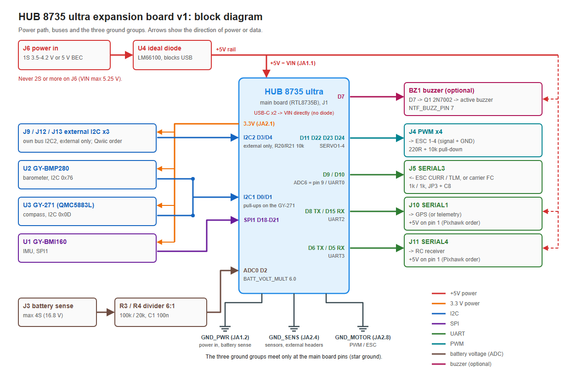
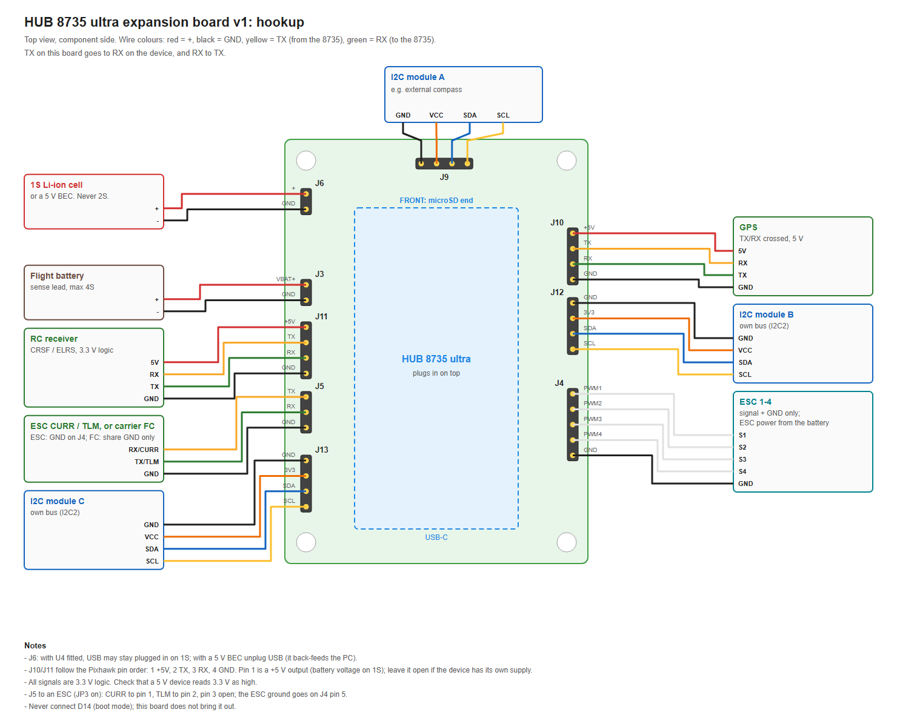

# Example: hand-built expansion board

繁體中文：[README.md](README.md)

An expansion board soldered by hand on a 50 × 70 mm perfboard that turns a HUB 8735 ultra into a flight controller: three sensor modules (the same set as the [first example](../bmi160-bmp280-qmc5883l/README.en.md)), plus headers for battery voltage sensing, four motor outputs, ESC current and telemetry, a GPS, an RC receiver and external I²C devices. The board plugs into it. This is a board the author built for their own use, published as it is; if you build it, judge and adapt it for your own parts and use.

**This board has not yet been tested on a public HAL repository tag, and it has not flown.** The ESC, GPS and RC receiver interfaces: designed and implemented; verified by host tests and SITL only — not yet tested with a real device. For the status see "Board test"; before you start, read [Flight safety](../../README.en.md#flight-safety) on this repository's home page.

- HAL repository tag: `v0.1.1` (battery voltage and the ESC version need a later HAL release, see "Files and HAL versions")
- Board type: `hub8735ultra`

## Sensor set

| Sensor | Module | Interface | Address or CS | Orientation in the overlay |
|---|---|---|---|---|
| IMU | GY-BMI160 | SPI bus 1 | CS on D21 | `ROTATION_NONE`, to be confirmed by the gravity test |
| Barometer | GY-BMP280 | I²C bus 1 | 0x76 | — |
| Compass | GY-271 (QMC5883L) | I²C bus 1, external | 0x0D | `ROTATION_NONE`, to be confirmed by the turn test |

Orientations assume the board component side up, with the front at the microSD end (the end opposite the USB-C connectors). The modules sit differently on this expansion board than in the first example, so the IMU orientation is not settled yet; once the board is built, confirm it with the gravity test and the turn test under "Board test".

## Expansion board headers

| Header | Use | Board pins |
|---|---|---|
| J6 | Power input: a 1S LiPo or a 5 V BEC | 5V (VIN), GND |
| J3 | Battery voltage sensing, up to 4S | D2 (analog pin 2) |
| J4 | Four motor outputs (PWM; DShot with the ESC version) | D11, D22, D23, D24 |
| J5 | ESC current and telemetry (jumper JP3 fitted), or SERIAL3 | D9, D10 |
| J10 | GPS (SERIAL1) | D8, D15 |
| J11 | RC receiver (SERIAL4) | D6, D5 |
| J9 | External I²C (second bus, I2C2) | D3, D4 |



This block diagram and the device hookup figure under "Wiring" are figures of the v1 PCB this board is based on. Correction: this board has no U4, so never plug in USB while J6 is powered, and it has no J12 or J13.

## Files and HAL versions

| File | Contents | With HAL repository `v0.1.1` |
|---|---|---|
| `overlay.dat` | The three sensors; the second I²C bus on J9 | Works |
| `overlay-esc.dat` | ESC current and telemetry on J5 (use with JP3 fitted); includes `overlay.dat` | Does not work: `v0.1.1` has a single analog pin and no receive-only serial ports, so the build stops with an error |
| `params/10-board.parm` | Failsafes | Works |
| `params/20-use-indoor-no-gps-no-rc.parm` | Indoors, ground station only | Works |
| `params/20-use-gps-rc-receiver.parm` | GPS on J10, RC receiver on J11 | Works |
| `params/30-frame-quad-x-esc.parm` | Example frame, ESCs on normal PWM | Works |
| `params/40-sensors.parm` | This sensor set | Works |
| `params/50-battery-voltage.parm` | Battery voltage on J3 | Does not work: `v0.1.1` does not convert analog readings to volts, and the battery monitor reports unavailable |
| `params/60-esc-current-telemetry-dshot.parm` | ESC current, ESC telemetry, DShot300 | Does not work: `v0.1.1` has no DShot, and it needs `overlay-esc.dat` |
| `perfboard.en.md`, `perfboard/` | Perfboard wiring table, parts, soldering steps, and the author's build figures (one of the parts side, four of the solder side) | — |
| `block-diagram.en.png`, `hookup.en.png` | Block diagram and device hookup of the v1 PCB (how this board differs is noted next to them) | — |

The three files that do not work wait for a later HAL release with analog volts, several analog pins, receive-only serial ports and DShot; once it is out, this example moves to that tag.

## Wiring

For the header positions and the D number of every pin, see this repository's [header figure](../../README.en.md#board-headers): seen from the component side with USB-C at the bottom, the left row has JA1 above and JA7 below, the right row JA2 above and JA8 below, and pin 1 of each group is at the microSD end.

### Perfboard

The author's actual perfboard layout: one figure of the parts side and four layers of wires on the solder side, with the parts list, the route of every wire, the soldering steps and the checks before plugging in the board, in [perfboard.en.md](perfboard.en.md). The figures are the author's own build figures: "Board A" is this expansion board, "v1" is the PCB design it is based on (not published), and JP3 "off: carrier" means J5 going to another flight controller, which in this example is J5 as a serial port. Positions are a suggestion: move a part if it does not fit, but keep the connections in the tables below.


### Sensor modules

| Module | Module pin | Connect to | Header position |
|---|---|---|---|
| GY-BMI160 | 3V3 | 3.3 V | JA2.1 |
| GY-BMI160 | GND | sensor GND | JA2.4 |
| GY-BMI160 | SCL | D19 (SPI clock) | JA8.2 |
| GY-BMI160 | SDA | D20 (SPI MOSI) | JA8.3 |
| GY-BMI160 | SAO | D18 (SPI MISO) | JA8.1 |
| GY-BMI160 | CS | D21 (SPI CS) | JA8.4 |
| GY-BMI160 | VIN, OCS, INT1, INT2, SCX, SDX | not connected | — |
| GY-BMP280 | VCC | 3.3 V | JA2.1 |
| GY-BMP280 | GND | sensor GND | JA2.4 |
| GY-BMP280 | SCL | D1 (I²C SCL) | JA1.4 |
| GY-BMP280 | SDA | D0 (I²C SDA) | JA1.3 |
| GY-BMP280 | CSB | 3.3 V (selects I²C) | JA2.1 |
| GY-BMP280 | SDO | sensor GND (address 0x76) | JA2.4 |
| GY-271 | VCC | 3.3 V | JA2.1 |
| GY-271 | GND | sensor GND | JA2.4 |
| GY-271 | SCL | D1 (I²C SCL) | JA1.4 |
| GY-271 | SDA | D0 (I²C SDA) | JA1.3 |
| GY-271 | DRDY | not connected | — |

- Connect every module to 3.3 V, never to 5 V: the RTL8735B's I/O is 3.3 V.
- I²C bus 1 has no extra pull-up resistors on the expansion board; it relies on the GY-271 module's own (inferred from the module sellers' specifications, not measured). Without a GY-271, add a 10 kΩ from each of D0 and D1 to 3.3 V (R1 and R2 on the perfboard).
- Pins not to connect: D14 (JA2.2), D12 (JA7.7), D13 (JA7.8), D16 (JA2.6), D17 (JA2.7), marked ✕ in the perfboard figures. The level of D14 at reset decides whether the chip enters download mode, and shorting it to the 3.3 V next to it (JA2.1) before a reset enters download mode (pages 17–18 of the vendor's Chinese user guide, `HUB 8735 ultra toolkit/Software/HUB 8735 ultra 開發板【Arduino 使用說明】_20240508.pdf` in ideashatch/HUB-8735 `870a7e08de7a`), so take care not to bridge them when soldering; D12 is the upgrade button, D13 drives the white fill light on the board in our tests, and D16 and D17 are the LOG UART (see [Board types](https://github.com/rainwu0/ArduPilot-RTL8735B/blob/v0.1.1/libraries/AP_HAL_RTL8735B/README.en.md#board-types) in the HAL repository README).
- Keep the compass away from power wires, the battery and magnetic parts.

### Expansion board headers



This is a figure of the v1 PCB. Correction: this board has no U4, so never plug in USB while J6 is powered (the first note under the figure does not apply), and it has no J12 or J13.

All headers are 2.54 mm. TX and RX are seen from the board: a device's RX goes to this board's TX. Resistors are 1/4 W through-hole; capacitors are ceramic, rated 10 V or more.

| Header | Pin | Signal | Connect to | Header position |
|---|---|---|---|---|
| J6 power input | 1 | + (1S LiPo or 5 V BEC) | straight to 5V (VIN) | JA1.1 |
| J6 power input | 2 | GND | power GND | JA1.2 |
| J3 battery voltage | 1 | battery +, up to 4S | 100 kΩ (1%) to D2; D2 also has 20 kΩ (1%) and 100 nF to power GND | JA1.5 |
| J3 battery voltage | 2 | GND | power GND | JA1.2 |
| J4 motor outputs | 1–4 | PWM1–PWM4 (SERVO1–4) | D11, D22, D23, D24, each through 220 Ω; each pin also 10 kΩ to motor GND | JA7.6, JA8.5, JA8.6, JA8.7 |
| J4 motor outputs | 5 | GND | motor GND (the ESC ground goes here too) | JA2.8 |
| J5 ESC / SERIAL3 | 1 | ESC CURR (JP3 fitted) or TX | 1 kΩ in series to D9; D9 has 100 nF through jumper JP3 to sensor GND | JA7.4 |
| J5 ESC / SERIAL3 | 2 | ESC TLM (JP3 fitted) or RX | 1 kΩ in series to D10; this pin also has 10 kΩ to 3.3 V | JA7.5 |
| J5 ESC / SERIAL3 | 3 | GND | sensor GND; not connected with an ESC | JA2.4 |
| J10 GPS (SERIAL1) | 1 | +5V out | 5V (VIN): the battery voltage on 1S | JA1.1 |
| J10 GPS (SERIAL1) | 2 | TX | D8 through 100 Ω | JA7.3 |
| J10 GPS (SERIAL1) | 3 | RX | 1 kΩ in series to D15 | JA2.3 |
| J10 GPS (SERIAL1) | 4 | GND | sensor GND | JA2.4 |
| J11 RC (SERIAL4) | 1 | +5V out | 5V (VIN): the battery voltage on 1S | JA1.1 |
| J11 RC (SERIAL4) | 2 | TX | D6 through 100 Ω | JA7.1 |
| J11 RC (SERIAL4) | 3 | RX | 1 kΩ in series to D5 | JA1.8 |
| J11 RC (SERIAL4) | 4 | GND | sensor GND | JA2.4 |
| J9 external I²C (I2C2) | 1 | GND | sensor GND | JA2.4 |
| J9 external I²C (I2C2) | 2 | 3V3 | 3.3 V | JA2.1 |
| J9 external I²C (I2C2) | 3 | SDA | D3; 10 kΩ to 3.3 V | JA1.6 |
| J9 external I²C (I2C2) | 4 | SCL | D4; 10 kΩ to 3.3 V | JA1.7 |

Optional ADC test header J14 (GND, TP, 3V3): D2 reaches TP through 1 kΩ, and jumper JP1 separates D2 from the battery divider. Normally JP1 is fitted and J14 left empty.

- **Jumper JP3**: fit it only when J5 goes to an ESC and the ESC image (`overlay-esc.dat`) is flashed; remove it when J5 is a serial port. With JP3 fitted, D9 is an analog input, and the 1 kΩ and 100 nF filter the ESC's current signal. If JP3 and the image do not match, the UART and the analog input claim the same pin, D9.
- **ESC current**: 4-in-1 ESCs are mostly designed for 3.3 V flight-controller inputs; this board sets 3.0 V as the limit on D9, to leave some margin. If CURR can exceed 3.0 V at the ESC's highest current, solder a 10 kΩ across the 100 nF capacitor: with the 1 kΩ it divides by 0.91.
- **ESC telemetry**: an ESC lets go of its telemetry line between packets, so J5 pin 2 has a 10 kΩ pull-up (inferred). Some ESCs drive TLM at 5 V: measure before connecting, and stop if it is above 3.3 V.
- **Grounds**: the three GND pins of the board are one net. Power GND goes to JA1.2 (J6, J3 and the divider), sensor GND to JA2.4 (the modules and every header except J4), motor GND to JA2.8 (J4 and its pull-downs). The three join only on the board. With an ESC, the ESC ground goes only to J4 pin 5 and J5 pin 3 stays open, so the two grounds do not form a loop through the ESC.
- **J9**: the external I2C2 has its own pair of 10 kΩ pull-ups on the board. A device on J9 also needs its driver line in the overlay (a `COMPASS` line, for example); `overlay.dat` only enables the bus.
- **5 V on J10 and J11**: pin 1 is the board's VIN, which on 1S is the battery voltage (3.5–4.2 V). Leave it unconnected for devices with their own supply; check that the GPS or receiver works at this voltage, or give it its own 5 V.

### Power

- J6 goes straight to the board's 5V (VIN), with no ideal diode in between. **While J6 is powered, do not plug in either USB-C**: per the vendor's schematic, the USB 5 V goes straight to the 5V header pin and would flow into the battery. To use USB, first remove power from J6.
- 1S (3.5–4.2 V) is below the supply voltage of 4.75–5.25 V on page 4 of the vendor's module specification. This board is designed to run on 1S, but when the battery voltage sags the board may reset; for a steady supply use a 5 V BEC. 2S or more destroys the board.
- J6 is a plain two-pin header with no polarity key: check the polarity with a meter before connecting a battery for the first time. If the battery has a JST-PH plug, a keyed JST-PH socket can be fitted on J6 instead.

## Build

Set up the environment and the Wi-Fi settings file and flash as in the HAL repository's [Getting started](https://github.com/rainwu0/ArduPilot-RTL8735B/blob/v0.1.1/libraries/AP_HAL_RTL8735B/GETTING_STARTED.en.md), and use this example's overlay when you build:

```bash
cd ~/ArduPilot-RTL8735B
git checkout v0.1.1
./waf configure --board hub8735ultra --extra-hwdef $HOME/ArduPilot-Hub8735Ultra/examples/expansion-board-handbuilt/overlay.dat
./waf copter
```

- With JP3 fitted and an ESC on J5, use `overlay-esc.dat` instead (it includes `overlay.dat`, so give only this one file). It needs a later HAL release; a `v0.1.1` build stops with an error.
- No firmware images are provided: an image contains your Wi-Fi credentials, so build your own.
- Needs HAL repository `v0.1.1` or later: `v0.1.1` clears the I²C bus at boot (see the HAL repository [CHANGELOG](https://github.com/rainwu0/ArduPilot-RTL8735B/blob/v0.1.1/libraries/AP_HAL_RTL8735B/CHANGELOG.en.md)) and supports a second I²C bus.

## Parameters

Use your ground station's load-parameters-from-file feature to load the files in `params/` in the order of their numbers, then reboot:

1. `10-board.parm`: failsafes for control over Wi-Fi only, the same as in the first example. Land when RC override stops (`FS_THR_ENABLE 3`), land when the ground station link is lost (`FS_GCS_ENABLE 5`), and keep landing if a failsafe starts while landing (`FS_OPTIONS 8`).
2. One of the two `20-` files:
   - `20-use-indoor-no-gps-no-rc.parm`: indoors, no GPS and no RC receiver. `GPS1_TYPE 0`; `RC_OPTIONS 33`: no receiver, and arming only with the throttle at its lowest.
   - `20-use-gps-rc-receiver.parm`: GPS on J10 (`SERIAL1_PROTOCOL 5`, `GPS1_TYPE 1` auto-detect), RC receiver on J11 (`SERIAL4_PROTOCOL 23`, a CRSF/ELRS-type serial receiver; SBUS needs an inverter, which this board does not have). `RC_OPTIONS 32` turns the receiver back on after the indoor file.
3. `30-frame-quad-x-esc.parm`: an example frame, quad X, brushless ESCs on normal PWM at 490 Hz, the same as in the first example. For your own frame, change `FRAME_CLASS` and `FRAME_TYPE`. After fitting ESCs, calibrate them first, with the propellers off throughout.
4. `40-sensors.parm`: `COMPASS_USE 1`, so this compass is used for heading.
5. `50-battery-voltage.parm` (later HAL release): battery voltage on J3, `BATT_MONITOR 3`, `BATT_VOLT_PIN 2`, divider ratio `BATT_VOLT_MULT 6.0`. After loading, calibrate `BATT_VOLT_MULT` against a meter.
6. `60-esc-current-telemetry-dshot.parm` (later HAL release, JP3 fitted, ESC image): the main battery adds the ESC current on D9 (`BATT_MONITOR 4`, `BATT_CURR_PIN 9`), a second battery monitor reads the ESC telemetry (`BATT2_MONITOR 9`), and the four outputs switch to DShot300 (`MOT_PWM_TYPE 5`). Set `BATT_AMP_PERVLT` and `BATT_AMP_OFFSET` from the ESC's data, then check them against a meter; set `SERVO_BLH_POLES` to your motors' pole count.

After loading, calibrate the accelerometer and the compass in the ground station. For the compass calibration, pick the board up and turn it through the six orientations in three dimensions; turning it flat on a desk is not enough. Set `AHRS_ORIENTATION` for how the board is mounted on the frame, then confirm it with the gravity test below.

## Board test

| # | Check | Status |
|---|---|---|
| 1 | Boot and connection: Wi-Fi joined, the ground station receives heartbeats and can read parameters | Pending |
| 2 | Sensors: IMU, barometer and compass detected; after loading `params/` and calibrating, all health checks pass; about 1 g of acceleration at rest | Pending |
| 3 | IMU orientation: with the front down, the right side down and the left side down, all three signs are right (gravity test) | Pending |
| 4 | Compass orientation: after calibration, turning the board 90° on a level surface changes the heading by about 90°, and turning it back returns it to the starting value (turn test) | Pending |
| 5 | Second I²C bus on J9: a device connected to it is detected | Pending (several buses in HAL repository `v0.1.1` are verified by host tests only, not on a board) |
| 6 | Battery voltage on J3: reading against a meter, calibrate `BATT_VOLT_MULT` | Pending (needs a later HAL release) |
| 7 | Failsafe: ArduPilot SITL with `params/` loaded | Pending for the public version. `10-board.parm` is the same as in the first example, where SITL passed ([Board test in the first example](../bmi160-bmp280-qmc5883l/README.en.md#board-test)) |
| 8 | ESC current, ESC telemetry and DShot (J5, JP3, J4) | Designed and implemented; verified by host tests and SITL only — not yet tested with a real device. |
| 9 | GPS (J10) | Designed and implemented; verified by host tests and SITL only — not yet tested with a real device. |
| 10 | RC receiver (J11) | Designed and implemented; verified by host tests and SITL only — not yet tested with a real device. |
| 11 | Overlays: processed with the hwdef generator of HAL repository `v0.1.1` | `overlay.dat` passes, giving two I²C buses and the three sensors; `overlay-esc.dat` stops with the expected error (a single analog pin only) |
| 12 | No private data: this directory contains no keys, Wi-Fi credentials, local paths, IP addresses or hotspot names | Checked |

The host tests and SITL for checks 8–10 were run by the author on their own build; the public version is pending. In SITL the ESC, GPS and RC input are ArduPilot's simulated devices, which do not cover the HAL, the board or the real devices. Not done yet:

- ESC: TLM high and idle level on J5 pin 2 (3.0 V or more at idle), CURR zero offset with the ESC idle, current scale against a meter, telemetry packets from a real ESC, JP3 with the matching image on the board, DShot waveform on J4, ESC power-up and arming with DShot, motor spin with the propellers off.
- GPS: a fix outdoors, baud-rate auto-detection with the actual module, whether the module runs from J10 pin 1 on 1S, a GPS compass on J9.
- RC receiver: protocol detection with the actual receiver, channel mapping, failsafe when a real transmitter's link is lost, whether the receiver runs from J11 pin 1 on 1S.

### Gravity test (IMU orientation)

ArduPilot's body frame is X forward, Y right, Z down. With the board at rest, look at the raw accelerometer values (mG) in the ground station:

| Placement | Expected reading |
|---|---|
| Level, component side up | Z about −1000, X and Y about 0 |
| Front (microSD end) down | X about −1000 |
| Right side down | Y about −1000 |
| Left side down | Y about +1000 |

If an axis has the wrong sign, or a different axis moves, change the IMU's `ROTATION_*` in the overlay (or the parameter `AHRS_ORIENTATION` if the whole board is turned), then test again.

### Turn test (compass orientation)

1. First calibrate the compass in the ground station (pick the board up and turn it through the six orientations in three dimensions). Without calibration, the magnetic heading is not accurate.
2. Put the board down level and note the magnetic heading and the EKF yaw.
3. Turn it 90° clockwise on the level surface: both values must increase by about 90° and stay within a few degrees of each other; turn it back, and both must return to where they started.
4. If the magnetic heading moves the other way, or the angle is far off, change the compass's `ROTATION_*` in the overlay, calibrate again and repeat the test.
