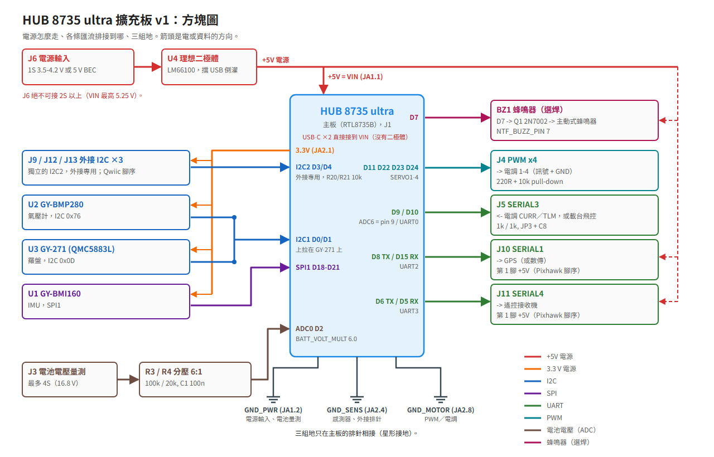
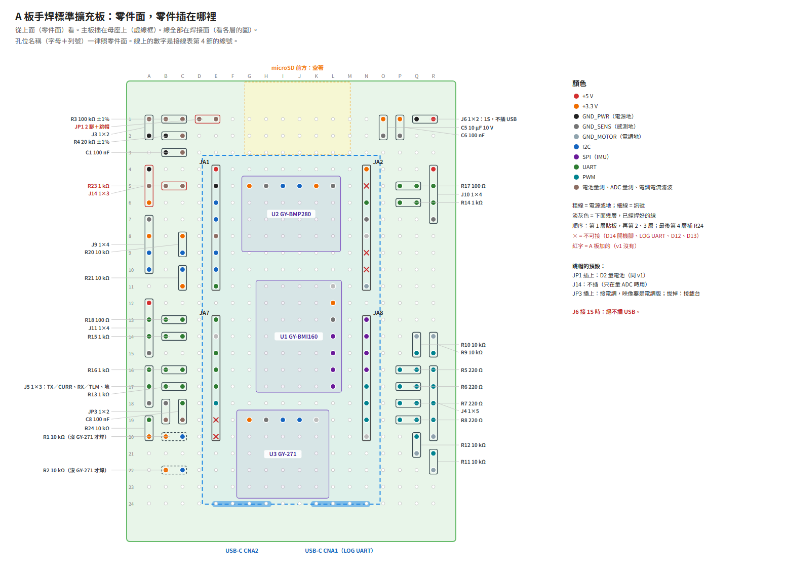
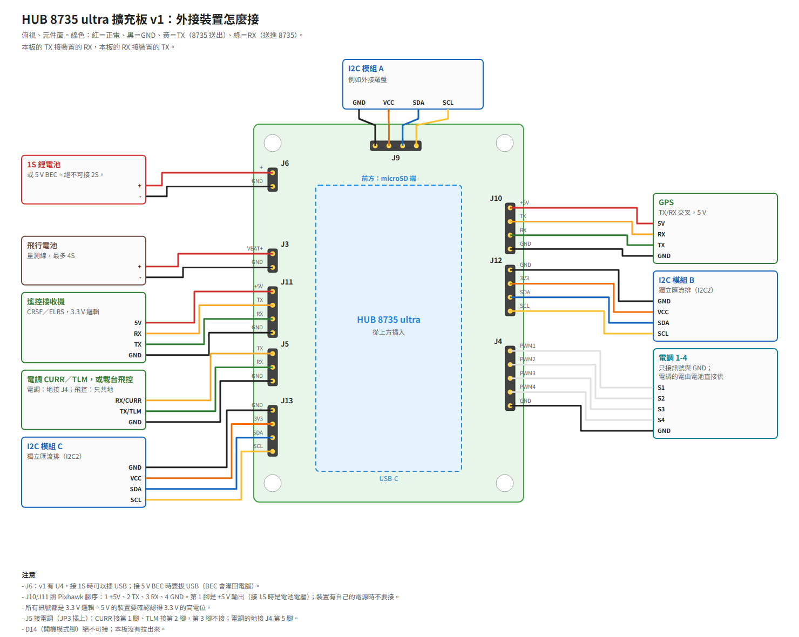

# 範例：手焊擴充板

English: [README.en.md](README.en.md)

一塊手焊在 50 × 70 mm 洞洞板上的擴充板，把 HUB 8735 ultra 做成飛控：三片感測器模組（和[第一個範例](../bmi160-bmp280-qmc5883l/README.md)同一組），加上電池電壓量測、四路馬達輸出、電調的電流與回傳、GPS、遙控接收機與外接 I²C 裝置的排針。開發板插在擴充板上。這是作者自己做來用的板子，照原樣公開；照著做的人請依自己的零件與用途判斷、調整。

**這塊板子還沒在公開的 HAL 庫標籤上做上板驗證，也還沒飛過。** 電調、GPS、遙控接收機三個介面：已設計並實作；只經主機測試與 SITL 驗證，還沒接實物測試。狀態見〈上板驗證〉；動手之前先讀本庫首頁的[〈飛行安全須知〉](../../README.md#飛行安全須知)。

- HAL 庫標籤：`v0.1.1`（電池電壓、電調版要之後的 HAL 版本，見〈檔案與 HAL 版本〉）
- 板型：`hub8735ultra`

## 感測器組合

| 感測器 | 模組 | 介面 | 位址或 CS | 疊加檔裡的方向 |
|---|---|---|---|---|
| IMU | GY-BMI160 | SPI 匯流排 1 | CS 接 D21 | `ROTATION_NONE`，待重力測試確認 |
| 氣壓計 | GY-BMP280 | I²C 匯流排 1 | 0x76 | — |
| 羅盤 | GY-271（QMC5883L） | I²C 匯流排 1，外接 | 0x0D | `ROTATION_NONE`，待轉向測試確認 |

方向以開發板元件面朝上、前方是 microSD 那一端（USB-C 的另一端）為準。模組在擴充板上的擺法和第一個範例不同，所以 IMU 的方向還沒定；焊好後用〈上板驗證〉的重力測試與轉向測試確認。

## 擴充板的排針

| 排針 | 用途 | 開發板的腳 |
|---|---|---|
| J6 | 電源輸入：1S 鋰電池或 5 V BEC | 5V（VIN）、GND |
| J3 | 電池電壓量測，最多 4S | D2（類比腳 2） |
| J4 | 四路馬達輸出（PWM；電調版用 DShot） | D11、D22、D23、D24 |
| J5 | 電調的電流與回傳（跳帽 JP3 插上），或 SERIAL3 | D9、D10 |
| J10 | GPS（SERIAL1） | D8、D15 |
| J11 | 遙控接收機（SERIAL4） | D6、D5 |
| J9 | 外接 I²C（第二條匯流排 I2C2） | D3、D4 |



這張方塊圖和〈接線〉的外接裝置接法圖，是這塊板子所依據的 v1 PCB 版的圖。更正：這塊板子沒有 U4，J6 接著電時不可插 USB，沒有 J12、J13。

## 檔案與 HAL 版本

| 檔案 | 內容 | 用 HAL 庫 `v0.1.1` |
|---|---|---|
| `overlay.dat` | 三個感測器；J9 的第二條 I²C 匯流排 | 可用 |
| `overlay-esc.dat` | J5 的電調電流與回傳（JP3 插上時用），會帶入 `overlay.dat` | 不能用：`v0.1.1` 只有一支類比腳、序列埠不能只收，建置時報錯 |
| `params/10-board.parm` | 失效保護 | 可用 |
| `params/20-use-indoor-no-gps-no-rc.parm` | 室內、只用地面站 | 可用 |
| `params/20-use-gps-rc-receiver.parm` | GPS 接 J10、遙控接收機接 J11 | 可用 |
| `params/30-frame-quad-x-esc.parm` | 機架範例，電調用一般 PWM | 可用 |
| `params/40-sensors.parm` | 這組感測器 | 可用 |
| `params/50-battery-voltage.parm` | J3 的電池電壓 | 不能用：`v0.1.1` 的類比輸入不換算電壓，電池監測會回報不可用 |
| `params/60-esc-current-telemetry-dshot.parm` | 電調電流、電調回傳、DShot300 | 不能用：`v0.1.1` 沒有 DShot，也要搭 `overlay-esc.dat` |
| `perfboard.md`、`perfboard/` | 洞洞板的接線表、零件、焊接步驟，以及作者的建置圖（零件面一張、焊接面四層） | — |
| `block-diagram.png`、`hookup.png` | v1 PCB 版的方塊圖與外接裝置接法（和這塊板子的差異寫在圖旁） | — |

「不能用」的三個檔要等之後有類比電壓換算、多支類比腳、只收的序列埠與 DShot 的 HAL 版本；那一版發布後，這裡改寫成那個標籤。

## 接線

排針的位置與每支腳的 D 編號見本庫的[排針圖](../../README.md#開發板的排針)：從元件面看、USB-C 朝下，左排上組 JA1、下組 JA7，右排上組 JA2、下組 JA8，每組第 1 腳在 microSD 那一端。

### 洞洞板

作者實際的洞洞板佈線：零件面一張、焊接面四層的線，加上零件表、每一條線的走法、焊接步驟與插上開發板前的檢查，見 [perfboard.md](perfboard.md)。圖是作者建置這塊板子用的原圖：「A 板」就是這塊擴充板，「v1」是它所依據的 PCB 版設計（沒有公開）；JP3 的「拔掉：接載台」指 J5 接另一塊飛控的時候，在這個範例裡就是 J5 當序列埠。位置是建議，零件放不下可以挪，接法照下面的表。



### 感測器模組

| 模組 | 模組的腳 | 接到 | 排針位置 |
|---|---|---|---|
| GY-BMI160 | 3V3 | 3.3 V | JA2.1 |
| GY-BMI160 | GND | 感測地 | JA2.4 |
| GY-BMI160 | SCL | D19（SPI 時脈） | JA8.2 |
| GY-BMI160 | SDA | D20（SPI MOSI） | JA8.3 |
| GY-BMI160 | SAO | D18（SPI MISO） | JA8.1 |
| GY-BMI160 | CS | D21（SPI CS） | JA8.4 |
| GY-BMI160 | VIN、OCS、INT1、INT2、SCX、SDX | 不接 | — |
| GY-BMP280 | VCC | 3.3 V | JA2.1 |
| GY-BMP280 | GND | 感測地 | JA2.4 |
| GY-BMP280 | SCL | D1（I²C SCL） | JA1.4 |
| GY-BMP280 | SDA | D0（I²C SDA） | JA1.3 |
| GY-BMP280 | CSB | 3.3 V（選 I²C） | JA2.1 |
| GY-BMP280 | SDO | 感測地（位址 0x76） | JA2.4 |
| GY-271 | VCC | 3.3 V | JA2.1 |
| GY-271 | GND | 感測地 | JA2.4 |
| GY-271 | SCL | D1（I²C SCL） | JA1.4 |
| GY-271 | SDA | D0（I²C SDA） | JA1.3 |
| GY-271 | DRDY | 不接 | — |

- 模組一律接 3.3 V，不要接 5 V：RTL8735B 的 I/O 是 3.3 V。
- I²C 匯流排 1 在擴充板上沒有另加上拉電阻，靠 GY-271 模組自帶的上拉（依模組賣場規格的推論，沒有量過）。沒裝 GY-271 時，D0、D1 各加一顆 10 kΩ 到 3.3 V（洞洞板上的 R1、R2）。
- 不要接的腳：D14（JA2.2）、D12（JA7.7）、D13（JA7.8）、D16（JA2.6）、D17（JA2.7），洞洞板的圖上標 ✕。D14 在重置時的電位決定是否進燒錄模式，和旁邊的 3.3 V（JA2.1）短路後重置就會進燒錄模式（板商中文使用說明 p.17–18：ideashatch/HUB-8735 `870a7e08de7a` 的 `HUB 8735 ultra toolkit/Software/HUB 8735 ultra 開發板【Arduino 使用說明】_20240508.pdf`），焊接時小心不要碰在一起；D12 是 upgrade 鍵，D13 實測上控制板上的白色補光燈，D16、D17 是 LOG UART（見 HAL 庫 README 的[〈板型〉](https://github.com/rainwu0/ArduPilot-RTL8735B/blob/v0.1.1/libraries/AP_HAL_RTL8735B/README.md#板型)）。
- 羅盤要遠離電源線、電池與磁性零件。

### 擴充板的排針



這張是 v1 PCB 版的圖。更正：這塊板子沒有 U4，J6 接著電時不可插 USB（圖下第一條注意不適用），沒有 J12、J13。

排針都是 2.54 mm。TX、RX 從開發板看：裝置的 RX 接這塊板子的 TX。電阻用 1/4 W 插件，電容用陶瓷、耐壓 10 V 以上。

| 排針 | 腳 | 訊號 | 接到 | 排針位置 |
|---|---|---|---|---|
| J6 電源輸入 | 1 | +（1S 鋰電池或 5 V BEC） | 直接接 5V（VIN） | JA1.1 |
| J6 電源輸入 | 2 | GND | 電源地 | JA1.2 |
| J3 電池電壓量測 | 1 | 電池正極，最多 4S | 100 kΩ（1%）接 D2；D2 再接 20 kΩ（1%）與 100 nF 到電源地 | JA1.5 |
| J3 電池電壓量測 | 2 | GND | 電源地 | JA1.2 |
| J4 馬達輸出 | 1–4 | PWM1–PWM4（SERVO1–4） | D11、D22、D23、D24 各串 220 Ω；每腳各接 10 kΩ 到馬達地 | JA7.6、JA8.5、JA8.6、JA8.7 |
| J4 馬達輸出 | 5 | GND | 馬達地（電調的地也接這裡） | JA2.8 |
| J5 電調／SERIAL3 | 1 | 電調 CURR（JP3 插上）或 TX | 串 1 kΩ 到 D9；D9 經 100 nF 與跳帽 JP3 到感測地 | JA7.4 |
| J5 電調／SERIAL3 | 2 | 電調 TLM（JP3 插上）或 RX | 串 1 kΩ 到 D10；這一腳另接 10 kΩ 到 3.3 V | JA7.5 |
| J5 電調／SERIAL3 | 3 | GND | 感測地；接電調時不接 | JA2.4 |
| J10 GPS（SERIAL1） | 1 | +5V 輸出 | 5V（VIN）：接 1S 時是電池電壓 | JA1.1 |
| J10 GPS（SERIAL1） | 2 | TX | D8 串 100 Ω | JA7.3 |
| J10 GPS（SERIAL1） | 3 | RX | 串 1 kΩ 到 D15 | JA2.3 |
| J10 GPS（SERIAL1） | 4 | GND | 感測地 | JA2.4 |
| J11 遙控（SERIAL4） | 1 | +5V 輸出 | 5V（VIN）：接 1S 時是電池電壓 | JA1.1 |
| J11 遙控（SERIAL4） | 2 | TX | D6 串 100 Ω | JA7.1 |
| J11 遙控（SERIAL4） | 3 | RX | 串 1 kΩ 到 D5 | JA1.8 |
| J11 遙控（SERIAL4） | 4 | GND | 感測地 | JA2.4 |
| J9 外接 I²C（I2C2） | 1 | GND | 感測地 | JA2.4 |
| J9 外接 I²C（I2C2） | 2 | 3V3 | 3.3 V | JA2.1 |
| J9 外接 I²C（I2C2） | 3 | SDA | D3；10 kΩ 到 3.3 V | JA1.6 |
| J9 外接 I²C（I2C2） | 4 | SCL | D4；10 kΩ 到 3.3 V | JA1.7 |

選焊的 ADC 量測排針 J14（GND、TP、3V3）：D2 經 1 kΩ 接到 TP，跳帽 JP1 把 D2 和電池分壓分開。平常 JP1 插著、J14 不插。

- **跳帽 JP3**：只有 J5 接電調、板上是電調版映像（`overlay-esc.dat`）時才插；J5 當序列埠時拔掉。JP3 插上時 D9 是類比輸入，1 kΩ 與 100 nF 濾電調的電流訊號。JP3 和映像不一致時，UART 和類比輸入會搶同一支腳 D9。
- **電調電流**：4-in-1 電調多半照 3.3 V 的飛控輸入設計；這塊板子把 D9 的上限定在 3.0 V，留一點餘裕。電調在最大電流時 CURR 可能超過 3.0 V 的話，在 100 nF 電容上並一顆 10 kΩ：和 1 kΩ 分壓 ×0.91。
- **電調回傳**：電調在兩包之間會放開回傳線，所以 J5 第 2 腳有 10 kΩ 上拉（推論）。有的電調 TLM 是 5 V：接上前先量，超過 3.3 V 就先停。
- **地**：開發板上三支 GND 是同一個網。電源地接 JA1.2（J6、J3 與分壓），感測地接 JA2.4（模組與 J4 以外的所有排針），馬達地接 JA2.8（J4 與它的下拉）。三組只在開發板上相接。接電調時，電調的地只接 J4 第 5 腳，J5 第 3 腳不接，兩組地才不會經電調繞成迴路。
- **J9**：外接的 I2C2 板上有自己的一組 10 kΩ 上拉。J9 上的裝置還要在疊加檔加它的驅動那一行（例如一行 `COMPASS`），`overlay.dat` 只開了匯流排。
- **J10、J11 的 5 V**：第 1 腳是板子的 VIN，接 1S 時是電池電壓（3.5–4.2 V）。裝置有自己的電源時不要接；GPS 或接收機要確認這個電壓能用，不能用就另外接 5 V。

### 電源

- J6 直接接到開發板的 5V（VIN），中間沒有理想二極體。**J6 接著電時，兩個 USB-C 都不要插**：依板商原理圖，USB 的 5 V 直接接到排針的 5V，會灌進電池。要用 USB，先拔掉 J6 的電源。
- 1S（3.5–4.2 V）低於板商模組規格書 p.4 列的電源電壓 4.75–5.25 V。這塊板子照接 1S 設計，但電池電壓一沉，開發板可能重開；要穩定就接 5 V BEC。2S 以上會燒壞開發板。
- J6 是兩腳排針，沒有防呆：第一次接電池前先用電表確認正負。電池是 JST-PH 插頭的話，J6 可以改焊有方向的 JST-PH 座。

## 建置

環境、Wi-Fi 設定檔與燒錄照 HAL 庫的[〈從零開始〉](https://github.com/rainwu0/ArduPilot-RTL8735B/blob/v0.1.1/libraries/AP_HAL_RTL8735B/GETTING_STARTED.md)，建置時改用這個範例的疊加檔：

```bash
cd ~/ArduPilot-RTL8735B
git checkout v0.1.1
./waf configure --board hub8735ultra --extra-hwdef $HOME/ArduPilot-Hub8735Ultra/examples/expansion-board-handbuilt/overlay.dat
./waf copter
```

- JP3 插上、J5 接電調時，改用 `overlay-esc.dat`（它會帶入 `overlay.dat`，只要指定這一個檔）。這個檔要之後的 HAL 版本，用 `v0.1.1` 建置會報錯。
- 不提供韌體映像：映像裡有你的 Wi-Fi 帳密，請自己建置。
- 需要 HAL 庫 `v0.1.1` 以上：`v0.1.1` 開機時會先清 I²C 匯流排（HAL 庫的 [CHANGELOG](https://github.com/rainwu0/ArduPilot-RTL8735B/blob/v0.1.1/libraries/AP_HAL_RTL8735B/CHANGELOG.md)），也支援第二條 I²C 匯流排。

## 參數

用地面站的載入參數檔功能，照編號順序載入 `params/` 的檔案，再重開機：

1. `10-board.parm`：只用 Wi-Fi 控制時的失效保護，和第一個範例相同。遙控 override 停了就降落（`FS_THR_ENABLE 3`），地面站失聯就降落（`FS_GCS_ENABLE 5`），降落中碰到失效保護就繼續降落（`FS_OPTIONS 8`）。
2. 兩份 `20-` 選一份：
   - `20-use-indoor-no-gps-no-rc.parm`：室內、沒有 GPS 與遙控接收機。`GPS1_TYPE 0`；`RC_OPTIONS 33`：不用接收機，而且油門在最低才能解鎖。
   - `20-use-gps-rc-receiver.parm`：GPS 接 J10（`SERIAL1_PROTOCOL 5`、`GPS1_TYPE 1` 自動偵測），遙控接收機接 J11（`SERIAL4_PROTOCOL 23`，CRSF、ELRS 這類序列接收機；SBUS 要反相器，這塊板子沒有）。`RC_OPTIONS 32` 把室內那份關掉的接收機打開。
3. `30-frame-quad-x-esc.parm`：機架範例，四軸 X 型，無刷電調用一般 PWM、490 Hz，和第一個範例相同。換成自己的機架要改 `FRAME_CLASS`、`FRAME_TYPE`。裝上電調後先做電調校正，全程拆槳。
4. `40-sensors.parm`：`COMPASS_USE 1`，用這顆羅盤算航向。
5. `50-battery-voltage.parm`（之後的 HAL 版本）：J3 的電池電壓，`BATT_MONITOR 3`、`BATT_VOLT_PIN 2`、分壓比 `BATT_VOLT_MULT 6.0`。載入後用電表校 `BATT_VOLT_MULT`。
6. `60-esc-current-telemetry-dshot.parm`（之後的 HAL 版本，JP3 插上、電調版映像）：主電池加上 D9 的電調電流（`BATT_MONITOR 4`、`BATT_CURR_PIN 9`），第二組電池監測讀電調回傳（`BATT2_MONITOR 9`），四路輸出改 DShot300（`MOT_PWM_TYPE 5`）。`BATT_AMP_PERVLT`、`BATT_AMP_OFFSET` 照電調的資料設，再對電表校；`SERVO_BLH_POLES` 照馬達的極數。

載入之後，在地面站做加速度計與羅盤校正。羅盤校正要拿起板子照六個姿勢立體轉，只在桌面上平轉不夠。`AHRS_ORIENTATION` 依板子裝在機架上的方向設定，再用下面的重力測試確認。

## 上板驗證

| # | 檢查 | 狀態 |
|---|---|---|
| 1 | 開機與連線：Wi-Fi 連上，地面站收到心跳、讀得到參數 | 待驗 |
| 2 | 感測器：IMU、氣壓計、羅盤都偵測得到；載入 `params/`、校正之後健康檢查都通過；靜置時加速度大小約 1 g | 待驗 |
| 3 | IMU 方向：前端朝下、右側朝下、左側朝下，三種擺法的正負號都對（重力測試） | 待驗 |
| 4 | 羅盤方向：校正後水平轉 90°，航向跟著變約 90°，轉回原位後回到原值（轉向測試） | 待驗 |
| 5 | J9 的第二條 I²C 匯流排：接上一個裝置，偵測得到 | 待驗（HAL 庫 `v0.1.1` 的多條匯流排只經主機測試，未上板） |
| 6 | J3 的電池電壓：讀值對照電表，校 `BATT_VOLT_MULT` | 待驗（要之後的 HAL 版本） |
| 7 | 失效保護：用 ArduPilot 的 SITL 載入 `params/` | 公開版本待驗。`10-board.parm` 和第一個範例的相同，那邊的 SITL 通過（[第一個範例的〈上板驗證〉](../bmi160-bmp280-qmc5883l/README.md#上板驗證)） |
| 8 | 電調電流、電調回傳與 DShot（J5、JP3、J4） | 已設計並實作；只經主機測試與 SITL 驗證，還沒接實物測試。 |
| 9 | GPS（J10） | 已設計並實作；只經主機測試與 SITL 驗證，還沒接實物測試。 |
| 10 | 遙控接收機（J11） | 已設計並實作；只經主機測試與 SITL 驗證，還沒接實物測試。 |
| 11 | 疊加檔：用 HAL 庫 `v0.1.1` 的 hwdef 產生器處理 | `overlay.dat` 通過，產生兩條 I²C 匯流排與三個感測器；`overlay-esc.dat` 照預期報錯（類比腳只能一支） |
| 12 | 沒有私人資料：這個目錄沒有金鑰、Wi-Fi 帳密、本機路徑、IP、熱點名稱 | 已查 |

第 8～10 項的主機測試與 SITL 是作者在自己的建置上做的，公開版本待驗。SITL 的電調、GPS、遙控都是 ArduPilot 的模擬裝置，不包含 HAL、開發板與實物。各項還沒做的：

- 電調：J5 第 2 腳 TLM 的高電位與閒置電位（閒置 3.0 V 以上）、電調待機時 CURR 的零點、對電表校電流倍率、真電調的回傳封包、JP3 配對應映像上板、J4 的 DShot 波形、電調通電與 DShot 解鎖、拆槳轉馬達。
- GPS：室外定位、實際模組的鮑率自動偵測、模組能不能直接吃 1S 時 J10 第 1 腳的電壓、GPS 上的羅盤走 J9。
- 遙控接收機：實際接收機的協定偵測、通道對應、真遙控器斷訊時的失效保護、接收機能不能直接吃 1S 時 J11 第 1 腳的電壓。

### 重力測試（IMU 方向）

ArduPilot 的機體座標是 X 向前、Y 向右、Z 向下。板子靜止，在地面站看加速度計的原始值（mG）：

| 擺法 | 應該看到 |
|---|---|
| 水平，元件面朝上 | Z 約 −1000，X、Y 約 0 |
| 前端（microSD 端）朝下 | X 約 −1000 |
| 右側朝下 | Y 約 −1000 |
| 左側朝下 | Y 約 +1000 |

某一軸的正負號錯了，或動的是別的軸，就改疊加檔裡 IMU 的 `ROTATION_*`（整塊板子轉了方向時，改參數 `AHRS_ORIENTATION`），再測一次。

### 轉向測試（羅盤方向）

1. 先在地面站做羅盤校正（拿起板子照六個姿勢立體轉）。沒校正時磁航向不準。
2. 板子水平放好，記下磁航向與 EKF 的偏航角。
3. 水平順時針轉 90°：兩個值都要增加約 90°，彼此只差幾度；再轉回原位，兩個值都要回到原來的值。
4. 磁航向往反方向走，或轉的角度差很多，就改疊加檔裡羅盤的 `ROTATION_*`，重新校正再測。
