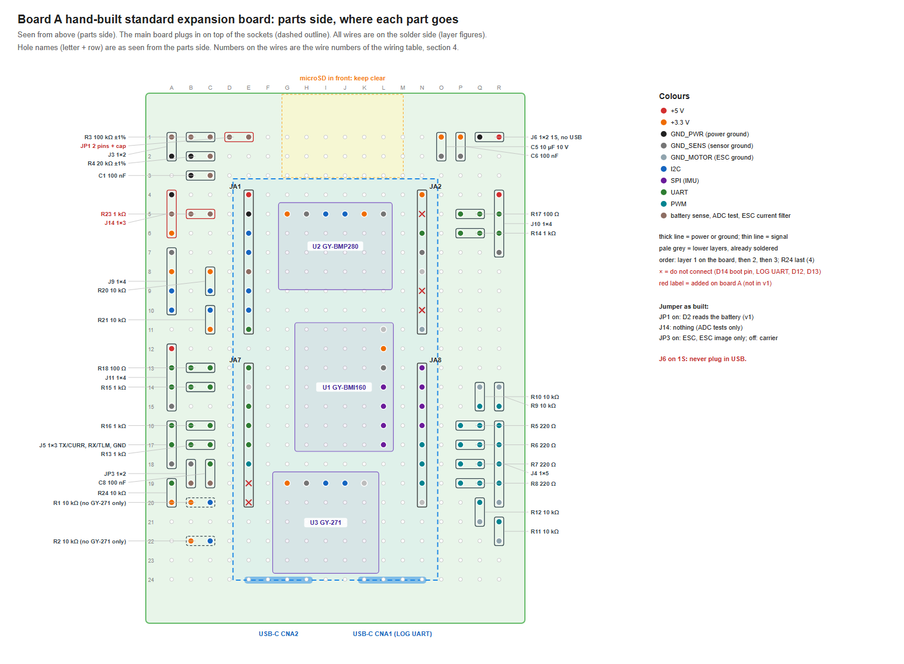

# Perfboard wiring table: hand-built expansion board

繁體中文：[perfboard.md](perfboard.md)

This is the actual perfboard layout of the expansion board in the [example](README.en.md). The main board (HUB 8735 ultra) plugs into two female header strips, the three sensor modules sit under it, and the headers and resistors are around the edge. The circuit is the same as in the example README's wiring tables; this adds which holes each part goes in, the route of every wire, and the soldering order and checks.

- The figures are the author's own build figures. "Board A" is this expansion board; "v1" is the PCB design it is based on, which is not published; JP3 "off: carrier" means J5 going to another flight controller, which in the example is J5 as a serial port. The red parts (R23, J14, JP1) are the ADC measurement parts this board adds to v1.
- **Every wire is on the solder side**, stacked in 4 layers: the parts side holds the sockets and modules, so no wires can run there; the wire is insulated, so stacking is fine. Within a layer no two wires cross or share a hole; a higher layer lies on top of the lower ones. Layer 1 has 53 wires, layer 2 19, layer 3 11, and layer 4 only the 2 wires of R24 (the 10 kΩ pull-up on J5 pin 2), which goes on last. A wire that lies over another net's joint is always on a higher layer than every wire soldered to that joint, so the joint is finished before anything lies on it; 18 joints are crossed this way.
- Wires follow the rows and columns of holes, and every wire has a number in the figures and in section 4.
- Positions are a suggestion: move a part if yours does not fit, but keep the connections.
- **Power**: J6 takes a 1S LiPo or a 5 V BEC, straight to VIN with no ideal diode in between. **Never plug in either USB-C while J6 is powered**: the USB 5 V would flow straight into the battery. Mark J6 on the board.

## 1. Parts

| Refs | Value | What | Qty | Note |
|---|---|---|---|---|
| U1 | GY-BMI160 | GY module | 1 |  |
| U2 | GY-BMP280 | GY module | 1 |  |
| U3 | GY-271 QMC5883L | GY module | 1 |  |
| R1, R2 | 10 kΩ | through-hole resistor | 2 | only without a GY-271 |
| R3 | 100 kΩ ±1% | through-hole resistor | 1 |  |
| R4 | 20 kΩ ±1% | through-hole resistor | 1 |  |
| R5–R8 | 220 Ω | through-hole resistor | 4 |  |
| R9–R12, R20, R21, R24 | 10 kΩ | through-hole resistor | 7 |  |
| R13–R16 | 1 kΩ | through-hole resistor | 4 |  |
| R17, R18 | 100 Ω | through-hole resistor | 2 |  |
| R23 | 1 kΩ | through-hole resistor | 1 | added on board A |
| C1, C6, C8 | 100 nF | ceramic capacitor, 10 V or more | 3 |  |
| C5 | 10 µF 10 V | ceramic capacitor, 10 V or more | 1 |  |
| J1 | HUB 8735 ultra | female header strip, 2.54 mm, 8.5 mm tall: one strip of 17 per side (cut from 1×20 or 1×40; the hole in row 12 is unused) | 2 |  |
| J3, J6 | 1×2 | male pin header, 2.54 mm, straight | 2 |  |
| J4 | 1×5 | male pin header, 2.54 mm, straight | 1 |  |
| J5 | 1×3 | male pin header, 2.54 mm, straight | 1 |  |
| J9–J11 | 1×4 | male pin header, 2.54 mm, straight | 3 |  |
| J14 | 1×3 | male pin header, 2.54 mm, straight | 1 | added on board A |
| JP1 | 2 pins + cap | 1×2 pin header and a jumper cap | 1 | added on board A |
| JP3 | 1×2 | male pin header 1×2, 2.54 mm, straight, with a jumper cap | 1 |  |

- A 50 × 70 mm perfboard (18 × 24 holes), two jumper caps (JP1, JP3), insulated wire (AWG 28–30; AWG 24–26 for the J6 power wires), heat-shrink.
- Without a GY-271, fit R1 and R2 (the pull-ups of I²C bus 1).

## 2. Main-board pins

Seen from the main board's component side, USB-C down.

| Pin | Name | Net | Goes to |
|---|---|---|---|
| JA1.1 | 5V/VIN | `+5V` | J10.1, J11.1, J6.1 |
| JA1.2 | GND | `GND_PWR` | J3.2, R4.2, C1.2, J14.1, J6.2 |
| JA1.3 | D0/I2C1_SDA | `I2C1_SDA` | U2.4, U3.4, R1.2 |
| JA1.4 | D1/I2C1_SCL | `I2C1_SCL` | U2.3, U3.3, R2.2 |
| JA1.5 | D2/ADC0 | `VBAT_ADC` | JP1.2, R23.1 |
| JA1.6 | D3/I2C2_SDA | `I2C2_SDA` | R20.2, J9.3 |
| JA1.7 | D4/I2C2_SCL | `I2C2_SCL` | R21.2, J9.4 |
| JA1.8 | D5/UART3_RX | `SERIAL4_RX` | R15.1 |
| JA7.1 | D6/UART3_TX | `SERIAL4_TX` | R18.1 |
| JA7.2 | D7/BUZZER | — | not connected (buzzer not fitted) |
| JA7.3 | D8/UART2_TX | `SERIAL1_TX` | R17.1 |
| JA7.4 | D9/UART0_TX | `SERIAL3_TX` | R16.1, C8.1 |
| JA7.5 | D10/UART0_RX | `SERIAL3_RX` | R13.1 |
| JA7.6 | D11/PWM1 | `PWM1` | R5.1 |
| JA7.7 | D12/UPGRADE | — | do not connect: upgrade key |
| JA7.8 | D13/LED | — | do not connect: on-board LED |
| JA2.1 | 3.3V | `+3V3` | U1.2, U2.1, U2.5, U3.1, R1.1, R2.1, C5.1, C6.1, J9.2, R20.1, R21.1, R24.1, J14.3 |
| JA2.2 | D14/BOOT | — | **do not connect: boot-mode pin, next to 3.3V** |
| JA2.3 | D15/UART2_RX | `SERIAL1_RX` | R14.1 |
| JA2.4 | GND | `GND_SENS` | U1.3, U2.2, U2.6, U3.2, J9.1, J5.3, J10.4, J11.4, C5.2, C6.2, JP3.2 |
| JA2.5 | VCC/VIN | — | second 5V (VIN) pin; this board uses JA1.1 |
| JA2.6 | D16/LOG_RX | — | do not connect: log UART RX |
| JA2.7 | D17/LOG_TX | — | do not connect: log UART TX |
| JA2.8 | GND | `GND_MOTOR` | J4.5, R9.2, R10.2, R11.2, R12.2 |
| JA8.1 | D18/SPI1_MISO | `SPI1_MISO` | U1.7 |
| JA8.2 | D19/SPI1_SCLK | `SPI1_SCLK` | U1.4 |
| JA8.3 | D20/SPI1_MOSI | `SPI1_MOSI` | U1.5 |
| JA8.4 | D21/SPI1_CS | `SPI1_CS` | U1.6 |
| JA8.5 | D22/PWM2 | `PWM2` | R6.1 |
| JA8.6 | D23/PWM3 | `PWM3` | R7.1 |
| JA8.7 | D24/PWM4 | `PWM4` | R8.1 |
| JA8.8 | SPK | — | spare (speaker output) |

## 3. Placement

Solder side, one figure per layer (seen from below, so left and right are swapped): [layer 1](perfboard/solder-layer1.en.png), [layer 2](perfboard/solder-layer2.en.png), [layer 3](perfboard/solder-layer3.en.png), [layer 4](perfboard/solder-layer4.en.png).

- Sockets: left row in column E, right row in column N (9 holes apart), pin 1 in row 4. The modules sit under the main board.
- Headers sit in the outer columns (A, R) and the top rows, each with its resistors next to it in the same row as the main-board pin it goes to, so most signals are short straight wires. Nothing goes in front of the microSD slot (columns G–L, rows 1–3) or past the USB-C end, so the debug USB-C (CNA1) and the microSD slot stay free.
- Tall parts (pin headers, standing resistors) only where the main board is not above them. A standing resistor next to the main board's edge stands in the outer hole and bends its other lead into the inner one.
- PWM pull-downs: the wires to R10 and R11 pass over the next channel's solder joint (insulated wire). Four channels on a 2.54 mm header leave no other way on a perfboard.
- C5 (10 µF): if it is an electrolytic, its negative lead goes in the sensor-ground hole (see the parts-side figure).

## 4. Every wire

Holes are named column letter + row, as seen from the **parts side** (A–R left to right, row 1 at the microSD end). On the solder side the letters run R–A. Each wire follows the holes listed (start, corners, end). Where two holes are next to each other, a solder bridge or a bent lead is enough. Solder layer 1 first, then layer 2 on top of it, then layer 3. "Over joints" lists the other nets' solder joints the wire lies across.

| # | Layer | Net | From | To | Route | mm | Over joints |
|---|---|---|---|---|---|---|---|
| 1 | 1 | `+5V` | J11.1 A12 | JA1.1 (5V) E4 | A12→D12→D4→E4 | 30 |  |
| 2 | 1 | `+5V` | J10.1 R4 | JA1.1 (5V) E4 | R4→R3→E3→E4 | 38 |  |
| 3 | 1 | `+5V` | J6.1 R1 | J10.1 R4 | R1→R4 | 8 |  |
| 4 | 1 | `+3V3` | C6.1 P1 | C5.1 O1 | P1→O1 | 3 |  |
| 5 | 1 | `+3V3` | U2.5 K5 | JA2.1 (3.3V) N4 | K5→K4→N4 | 10 |  |
| 6 | 1 | `+3V3` | U2.1 G5 | U2.5 K5 | G5→G4→K4→K5 | 15 |  |
| 7 | 1 | `+3V3` | J9.2 A8 | J14.3 A6 | A8→B8→B6→A6 | 10 |  |
| 8 | 1 | `+3V3` | R20.1 C8 | J9.2 A8 | C8→A8 | 5 |  |
| 9 | 1 | `+3V3` | R21.1 C11 | R20.1 C8 | C11→B11→B8→C8 | 13 |  |
| 10 | 1 | `+3V3` | U1.2 L12 | U2.5 K5 | L12→K12→K5 | 20 |  |
| 11 | 1 | `+3V3` | U3.1 G19 | U1.2 L12 | G19→G12→L12 | 30 |  |
| 12 | 1 | `+3V3` (only with R1/R2) | R1.1 B20 | U3.1 G19 | B20→B21→G21→G19 | 20 |  |
| 13 | 1 | `+3V3` (only with R1/R2) | R2.1 B22 | R1.1 B20 | B22→B20 | 5 |  |
| 14 | 1 | `GND_PWR` | R4.2 B2 | C1.2 B3 | B2→B3 | 3 |  |
| 15 | 1 | `GND_PWR` | J3.2 A2 | R4.2 B2 | A2→B2 | 3 |  |
| 16 | 1 | `GND_PWR` | J14.1 A4 | J3.2 A2 | A4→A2 | 5 |  |
| 17 | 1 | `GND_SENS` | J10.4 R7 | JA2.4 (GND) N7 | R7→N7 | 10 |  |
| 18 | 1 | `GND_SENS` | U2.6 L5 | JA2.4 (GND) N7 | L5→L7→N7 | 10 |  |
| 19 | 1 | `GND_SENS` | C6.2 P2 | C5.2 O2 | P2→O2 | 3 |  |
| 20 | 1 | `GND_SENS` | U1.3 L13 | JA2.4 (GND) N7 | L13→M13→M7→N7 | 20 |  |
| 21 | 1 | `GND_SENS` | JP3.2 B18 | J5.3 A18 | B18→A18 | 3 |  |
| 22 | 1 | `GND_SENS` | U3.2 H19 | U1.3 L13 | H19→H13→L13 | 25 |  |
| 23 | 1 | `GND_MOTOR` | R10.2 Q14 | JA2.8 (GND) N11 | Q14→Q11→N11 | 15 |  |
| 24 | 1 | `GND_MOTOR` | R9.2 R14 | R10.2 Q14 | R14→Q14 | 3 |  |
| 25 | 1 | `GND_MOTOR` | R11.2 R22 | R10.2 Q14 | R22→O22→O14→Q14 | 33 |  |
| 26 | 1 | `GND_MOTOR` | R12.2 Q21 | R11.2 R22 | Q21→Q22→R22 | 5 |  |
| 27 | 1 | `ADC_TP` | J14.2 A5 | R23.2 B5 | A5→B5 | 3 |  |
| 28 | 1 | `CURR_FILT` | JP3.1 B19 | C8.2 C19 | B19→C19 | 3 |  |
| 29 | 1 | `I2C1_SCL` (only with R1/R2) | R2.2 C22 | U3.3 I19 | C22→I22→I19 | 23 |  |
| 30 | 1 | `I2C1_SDA` | U2.4 J5 | JA1.3 (D0) E6 | J5→J6→E6 | 15 |  |
| 31 | 1 | `PWM1_OUT` | J4.1 R16 | R5.2 Q16 | R16→Q16 | 3 |  |
| 32 | 1 | `PWM1_OUT` | R9.1 R15 | J4.1 R16 | R15→R16 | 3 |  |
| 33 | 1 | `PWM2_OUT` | J4.2 R17 | R6.2 Q17 | R17→Q17 | 3 |  |
| 34 | 1 | `PWM3_OUT` | J4.3 R18 | R7.2 Q18 | R18→Q18 | 3 |  |
| 35 | 1 | `PWM4_OUT` | J4.4 R19 | R8.2 Q19 | R19→Q19 | 3 |  |
| 36 | 1 | `PWM4_OUT` | R12.1 Q20 | R8.2 Q19 | Q20→Q19 | 3 |  |
| 37 | 1 | `SERIAL1_RX` | R14.1 P6 | JA2.3 (D15) N6 | P6→N6 | 5 |  |
| 38 | 1 | `SERIAL1_RX_IN` | J10.3 R6 | R14.2 Q6 | R6→Q6 | 3 |  |
| 39 | 1 | `SERIAL1_TX_OUT` | J10.2 R5 | R17.2 Q5 | R5→Q5 | 3 |  |
| 40 | 1 | `SERIAL3_RX_IN` | J5.2 A17 | R13.2 B17 | A17→B17 | 3 |  |
| 41 | 1 | `SERIAL3_TX` | R16.1 C16 | JA7.4 (D9) E16 | C16→E16 | 5 |  |
| 42 | 1 | `SERIAL3_TX` | C8.1 C18 | JA7.4 (D9) E16 | C18→D18→D16→E16 | 10 |  |
| 43 | 1 | `SERIAL3_TX_OUT` | J5.1 A16 | R16.2 B16 | A16→B16 | 3 |  |
| 44 | 1 | `SERIAL4_RX_IN` | J11.3 A14 | R15.2 B14 | A14→B14 | 3 |  |
| 45 | 1 | `SERIAL4_TX` | R18.1 C13 | JA7.1 (D6) E13 | C13→E13 | 5 |  |
| 46 | 1 | `SERIAL4_TX_OUT` | J11.2 A13 | R18.2 B13 | A13→B13 | 3 |  |
| 47 | 1 | `SPI1_CS` | U1.6 L16 | JA8.4 (D21) N16 | L16→N16 | 5 |  |
| 48 | 1 | `SPI1_MOSI` | U1.5 L15 | JA8.3 (D20) N15 | L15→N15 | 5 |  |
| 49 | 1 | `SPI1_SCLK` | U1.4 L14 | JA8.2 (D19) N14 | L14→N14 | 5 |  |
| 50 | 1 | `VBAT_DIV` | JP1.1 D1 | R3.2 C1 | D1→C1 | 3 |  |
| 51 | 1 | `VBAT_DIV` | R4.1 C2 | R3.2 C1 | C2→C1 | 3 |  |
| 52 | 1 | `VBAT_DIV` | C1.1 C3 | R4.1 C2 | C3→C2 | 3 |  |
| 53 | 1 | `VBAT_SENSE` | R3.1 B1 | J3.1 A1 | B1→A1 | 3 |  |
| 54 | 2 | `+3V3` | C5.1 O1 | JA2.1 (3.3V) N4 | O1→N1→N4 | 10 |  |
| 55 | 2 | `+3V3` | J14.3 A6 | U2.1 G5 | A6→D6→D3→G3→G5 | 28 |  |
| 56 | 2 | `GND_SENS` | U2.2 H5 | U2.6 L5 | H5→H4→L4→L5 | 15 |  |
| 57 | 2 | `GND_SENS` | C5.2 O2 | JA2.4 (GND) N7 | O2→O7→N7 | 15 |  |
| 58 | 2 | `GND_SENS` | J9.1 A7 | U1.3 L13 | A7→D7→D21→H21→H13→L13 | 84 |  |
| 59 | 2 | `GND_SENS` | J11.4 A15 | J9.1 A7 | A15→D15→D7→A7 | 36 |  |
| 60 | 2 | `GND_SENS` | J5.3 A18 | J11.4 A15 | A18→A15 | 8 | A17, A16 |
| 61 | 2 | `GND_MOTOR` | J4.5 R20 | R9.2 R14 | R20→R14 | 15 | R19, R18, R17, R16, R15 |
| 62 | 2 | `I2C1_SCL` | U2.3 I5 | JA1.4 (D1) E7 | I5→I7→E7 | 15 |  |
| 63 | 2 | `I2C1_SDA` (only with R1/R2) | R1.2 C20 | U3.4 J19 | C20→C21→A21→A23→J23→J19 | 46 |  |
| 64 | 2 | `I2C2_SCL` | J9.4 A10 | R21.2 C10 | A10→C10 | 5 |  |
| 65 | 2 | `I2C2_SDA` | J9.3 A9 | R20.2 C9 | A9→C9 | 5 |  |
| 66 | 2 | `PWM2` | R6.1 P17 | JA8.5 (D22) N17 | P17→N17 | 5 |  |
| 67 | 2 | `PWM2_OUT` | R10.1 Q15 | R6.2 Q17 | Q15→Q17 | 5 | Q16 |
| 68 | 2 | `PWM3` | R7.1 P18 | JA8.6 (D23) N18 | P18→N18 | 5 |  |
| 69 | 2 | `PWM3_OUT` | R11.1 R21 | R7.2 Q18 | R21→R23→Q23→Q18 | 20 | R22, Q21, Q20, Q19 |
| 70 | 2 | `PWM4` | R8.1 P19 | JA8.7 (D24) N19 | P19→N19 | 5 |  |
| 71 | 2 | `SPI1_MISO` | U1.7 L17 | JA8.1 (D18) N13 | L17→M17→M13→N13 | 15 |  |
| 72 | 2 | `VBAT_ADC` | JP1.2 E1 | JA1.5 (D2) E8 | E1→M1→M8→E8 | 58 |  |
| 73 | 3 | `GND_PWR` | C1.2 B3 | JA1.2 (GND) E5 | B3→B4→D4→D5→E5 | 13 |  |
| 74 | 3 | `GND_PWR` | J6.2 Q1 | JA1.2 (GND) E5 | Q1→F1→F5→E5 | 41 | P1, O1 |
| 75 | 3 | `I2C1_SCL` | U3.3 I19 | U2.3 I5 | I19→I5 | 36 |  |
| 76 | 3 | `I2C1_SDA` | U3.4 J19 | U2.4 J5 | J19→J5 | 36 |  |
| 77 | 3 | `I2C2_SCL` | R21.2 C10 | JA1.7 (D4) E10 | C10→E10 | 5 |  |
| 78 | 3 | `I2C2_SDA` | R20.2 C9 | JA1.6 (D3) E9 | C9→E9 | 5 |  |
| 79 | 3 | `PWM1` | R5.1 P16 | JA7.6 (D11) E18 | P16→O16→O21→F21→F18→E18 | 48 |  |
| 80 | 3 | `SERIAL1_TX` | R17.1 P5 | JA7.3 (D8) E15 | P5→P3→G3→G15→E15 | 64 | G5 |
| 81 | 3 | `SERIAL3_RX` | R13.1 C17 | JA7.5 (D10) E17 | C17→E17 | 5 |  |
| 82 | 3 | `SERIAL4_RX` | R15.1 C14 | JA1.8 (D5) E11 | C14→D14→D11→E11 | 13 |  |
| 83 | 3 | `VBAT_ADC` | R23.1 C5 | JA1.5 (D2) E8 | C5→C6→D6→D8→E8 | 13 |  |
| 84 | 4 | `+3V3` | R24.1 A20 | U3.1 G19 | A20→A21→G21→G19 | 23 |  |
| 85 | 4 | `SERIAL3_RX_IN` | R24.2 A19 | R13.2 B17 | A19→D19→D17→B17 | 18 | B19, C19, C17 |

85 wires, numbered in soldering order, layer by layer; within a layer, power and ground first, and a wire that crosses joints comes after every wire that ends on those joints.

## 5. Soldering steps

1. Before: unplug USB and any battery; keep the main board off for now.
2. Sockets: two full female strips in columns E and N, pin 1 in row 4. Plug the main board in once to check the fit, then take it off again.
3. Modules: BMP280 in G5–L5, BMI160 in L11–L17, GY-271 in G19–K19; the BMP280 and GY-271 bodies toward the USB end, the BMI160 toward the left.
4. Resistors, capacitors, headers, JP1 and JP3 in the positions of the parts-side figure. R16 is 1 kΩ.
5. Turn the board over and lay the wires layer by layer, in the order of section 4: all of layer 1 flat on the board, then layer 2 on top of it, then layer 3, each in number order. Insulated wire for anything longer than two holes; a wire listed with "over joints" lies across those joints, which are already soldered by then: do not heat them again once it is on.
6. Last, R24 (10 kΩ pull-up on J5 pin 2): stand it in A19 (pin 2) and A20 (pin 1), then lay the layer-4 wires in section 4. A board already built to layers 1-3 takes R24 the same way: A19 and A20 are free, and no wire runs through them.
7. JA2.2 (D14, boot-mode pin) is right next to 3.3 V (JA2.1): no wire, no solder on it. Also leave JA2.6, JA2.7 (LOG UART), JA7.7, JA7.8 alone.
8. J6: + is R1, − is Q1. Write "1S OR 5 V, NO USB WHEN POWERED" next to it with a marker or a tape label. A plain 2-pin header has no polarity key, and a reversed battery puts reverse voltage straight into the main board: if the battery has a JST-PH 2-pin plug, fit the matching keyed JST-PH socket at R1/Q1 instead (+ on R1).
9. Jumpers: JP1 on (battery sense); nothing on J14. JP3 on when J5 goes to the ESC (CURR, TLM), off when J5 is a serial port (SERIAL3, "carrier" in the figures). JP3 must match the image: on only with the ESC image (`overlay-esc.dat`: D9 as analog pin 9, SERIAL3 receive-only), off with the normal image (`overlay.dat`). Mixed up, the UART and the analog input both claim D9. Label JP3 "ESC ONLY, ESC IMAGE": fitted while J5 is a serial port, it rounds off every TX edge (1 kΩ / 100 nF, 100 µs against an 8.7 µs bit) and the other end only sees bad frames.
10. ESC harness on J5 (ESC mode): ESC CURR → J5 pin 1, ESC TLM → J5 pin 2, nothing on J5 pin 3; the ESC's ground goes only to J4 pin 5 with the PWM/DShot wires. See section 7 for the 3.0 V limit on CURR.

## 6. Checks before plugging in the main board

With a meter, main board off, nothing powered:

1. 3.3 V (JA2.1) to each ground (JA1.2, JA2.4, JA2.8): not shorted.
2. 5 V (JA1.1) to ground: not shorted; 5 V to 3.3 V: not connected.
3. J6 +: connected to JA1.1; J6 −: connected to JA1.2.
4. Before the battery goes on J6 for the first time: on the battery's plug, the meter's red lead on the positive side must read a positive voltage when that side meets R1 (J6 +). Check it every time a different battery is used.
5. JA2.2 (D14) to anything: not connected.
6. JP1 off: D2 (JA1.5) to the divider (R4): not connected; JP1 on: connected.
7. J5 pin 1 to D9 (JA7.4): about 1 kΩ (R16). JP3 off: C8's free leg to sensor ground (JA2.4) not connected; JP3 on: connected.
8. J5 pin 2 to 3.3 V (JA2.1): about 10 kΩ (R24).
9. Each wire in section 4: continuity end to end (tick them off).

Then plug in the main board (component side up, USB-C toward row 24). Power it either from USB or from J6, never both.

## 7. After it is built

- Orientation: do the gravity test and the turn test under "Board test" in the example README.
- J9 (I2C2): `overlay.dat` enables the second I²C bus; a device on J9 also needs its driver line in the overlay.
- ADC on J14: take JP1 off first, then put a cap on J14 pins 1–2 (TP to GND) or 2–3 (TP to 3V3); for the mid point, plug two 1 kΩ across pins 3–2 and 2–1. During a measurement session, reboot with JP1 off and nothing on J14 (D2 sees only the open 1 kΩ); in normal use JP1 stays on. 3V3 is never next to GND.
- On 1S, the "5V" pin 1 of J10 and J11 carries the battery voltage (about 3.5–4.2 V), not 5 V. Devices that need a real 5 V get their own supply there.
- ESC mode (JP3 on): ESC CURR → J5 pin 1, ESC TLM → J5 pin 2, ESC ground only on J4 pin 5 (J5 pin 3 stays open, so the two grounds do not form a loop through the ESC).
  - CURR: 4-in-1 ESCs are mostly built for 3.3 V flight-controller analog inputs; this board sets 3.0 V as the limit on D9. Once the ESC model is known, work out the CURR voltage at the highest expected current from its current scale; if it is above 3.0 V, solder a 10 kΩ across C8 (on C8's two legs): with R16 it divides by 0.91, 3.3 V → 3.0 V, and `BATT_AMP_PERVLT` is calibrated with it in place. R16 also limits the current to about 3 mA if D9 is ever driven as TX in ESC mode.
  - TLM: ArduPilot joins the telemetry wires of all ESCs onto one RX pin, so an ESC's telemetry output lets go of the line between packets and the RX side has to hold it high (inference). R24 (10 kΩ from J5 pin 2 to 3V3) does that: whether the chip turns on an internal pull-up with RX only is not certain, and an external one is. It sits on the J5 side of R13, so a low from the ESC reaches D10 as 0 V. Check on board: with the ESC powered and not sending, J5 pin 2 reads 3.0 V or more to ground. R13's 1 kΩ is no problem at 115200 baud: with about 20 pF at the pin it adds about 20 ns to an 8.7 µs bit. Some ESCs drive TLM at 5 V push-pull: before connecting, measure the ESC's TLM high level once; above 3.3 V, stop and add a divider or level shifter (values from that ESC).
- DShot on J4: the line has 220 Ω in series and 10 kΩ to ground. No source gives a series resistor for DShot; inference from the values: 220 Ω with about 100 pF of lead and ESC input gives a time constant near 22 ns, against a bit of 3.33 µs at DShot300 or 1.67 µs at DShot600; the 10 kΩ draws about 0.3 mA. Bidirectional DShot (the ESC answers on the same line) idles high, which the 10 kΩ pull-down works against: try it on one channel first and remove that pull-down if the ESC's answers do not come through. Pass on board, on a scope at the J4 pin: high level 3.0 V or more, low level 0.3 V or less, rise and fall time under 0.1 µs, bit width within 5 % of the DShot rate. Scope it with the motors off the ESC or the propellers removed; any step that can spin a motor needs the propellers off and someone watching.
- GPS on J10 and RC receiver on J11 (Pixhawk pin order: 5V, TX, RX, GND); a GPS compass goes on J9.
- For the status of the ESC, GPS and RC receiver and what is not done yet, see "Board test" in the example README.
